---
puppeteer:
    landscape: false
    format: "legal"
    printBackground: true
    mediaType: "screen"
    timeout: 3000 # Wait for 3000ms before export
    scale: 0.64
    margin: 0

export_on_save:
    # puppeteer: ["pdf"]    # export PDF on save
---
@import "REY_ACADEMIA1.less"

</br>
</br>
</br>
<h1  style="font-size: 3.0em; margin-top:   0px; padding: 0" align=center>  Chapter 3                           </h1>
<h2  style="font-size: 2.0em; margin-top: -15px;"            align=center>  Formatted Input/Output              </h2>

<div style="font-size: 1.0em; margin-top:   0px;"            align=center>  CSE 4107 : Structured Programming I </div>
<div style="font-size: 1.0em; margin-top:   0px;"            align=center>  REYNEP                              </div>
</br>


<section class="REY_NO_PAGEBREAK">

## 3.0. characters

<div class="REY_BR6_NEGATIVE"></div>
<div style="display: flex; align-items: flex-start; gap: 20px;">

<!-- ============= 1 ============= -->
<div style="flex: 1">
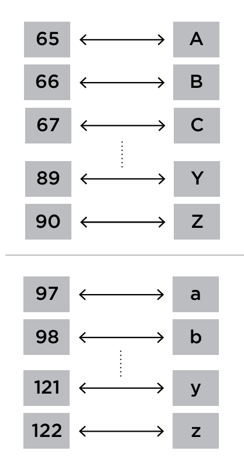
<div class="REY_BR4_NEGATIVE"></div>

@credit [cs50](https://cs50.harvard.edu/ap/2021/curriculum/x/references/ascii.pdf)

</div>
<!-- ============= 1 ============= -->

<!-- ============= 2 ============= -->
<div style="flex: 4;">

<div style="display: flex; align-items: flex-start; gap: 20px;">
<div style="flex: 1">

```cpp
char c = 'A'
char c = 65;  // same effect as last line

char l = 'b';       
char l = 98;  // same effect as last line
```

</div>
<div style="flex: ;">

```cpp
for (int i = 0; i < n; i++)
{
    char c = str[0];     // if c = '5'
     int k = '0' - c;    //    k = 5; 
}
```

</div>
</div>

<div style="display: flex; align-items: flex-start; gap: 20px;">
<div style="flex: ">

#### ASCII
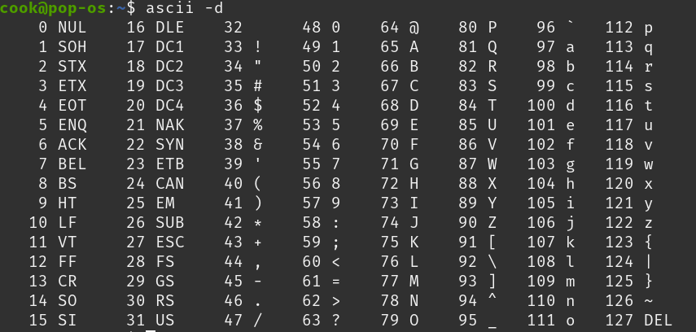

</div>
<div style="flex: ;">

#### characters
- `char` ➡️ 8-bit

</div>
</div>
<!-- ============= 2 ============= -->

</div>
</div>

</section>
</br>
</br>


<section class="REY_NO_PAGEBREAK">

## 3.1. The `printf()` function

<div class="REY_BR6_NEGATIVE"></div>
<div style="display: flex; align-items: flex-start; gap: 20px;">
<div style="flex: 1;">

```cpp
int i = 10;
int j = 20;
float x = 43.2892f;
float y = 5527.0f;

printf("hello, world!\n");
printf("i = %d, j = %i, x = %f, y = %f\n", i, j, x, y);
```

</div>
<div style="flex: 1;">

```cpp
// output
hello, world!
i = 10, j = 20, x = 43.289200, y = 5527.000000
```
</div>
</div>
<div class="REY_BR6_NEGATIVE"></div>

</section>


<section class="REY_NO_PAGEBREAK">

<div style="display: flex; align-items: flex-start; gap: 20px;">
<div style="flex: 1;">

#### "string"
<div class="REY_BR5_NEGATIVE"></div>

`"hello, world!\n"`
- This is called a **<u>String</u>**
- Whatever is `"` inside `"` Double-Quotes ➡️ **<u>String</u>**
- `\n` - **newline**
    - This is the **<u>ASCII</u>** Character `10`
    - Without this, <u>there'd be no 2nd line</u>

</div>
<div style="flex: 1.25;">

#### "conversion specification"
- `%d` - decimal
- `%i` - integer
- `%f` - float
    - These are called **<u>conversion specification</u>**
    - They start with a `%`
    - They must stay inside **<u>String</u>**
    - They get "<u>filled in</u>" with values of `i`, `j`, `x`, `y` during printing 💁‍♀️

</div>
</div>

#### "format string"
- The `printf()` function takes a <u>**string**</u> as input
- now, because `printf()` has built-in functionality to handle **<u>conversion specification</u>** (`%d`, `%` stuffs)
    - this <u>**string**</u> gets a special name
    - this <u>**string**</u> is called **"<u>format string</u>"**
    </br>
 
- 3 kinds of stuff that can be inside this **"<u>format string</u>"**
    1. **"ordinary characters"** ➡️ letters/buttons of a keyboard
        - simply, English Letters, Digits
        - stuff from the <u>ASCII</u> table 
    2. **"escape sequence"** ➡️ stuff like `\n` 
        - `\n` is also another <u>ASCII</u> character
    3. **"conversion specifications"** ➡️ `%d`, `%` stuffs
        - by using `%d`, `%` stuffs, we can insert values @ specified points in the <u>**string**</u> & those values will be printed 

</br>
</br>
</section>


<section class="REY_NO_PAGEBREAK">
<div class="REY_NOSHOW_MD">
    </br>
    </br>
    </br>
    </br>
    </br>
    </br>
</div>

#### using `%d`
<div style="display: flex; align-items: flex-start; gap: 20px;">
<div style="flex: 1;">

```cpp
int x = 50;

printf("welcome to cs%d", x);
printf("\n");
```
1.

</div>
<div style="flex: 2.2;">

```cpp
int x = 10;
int y = 20;
printf("x = %d, y = %d", x, y);
printf("\n");
```
2.

</div>
</div>

1. we used 1 `%d`, so we passed in 1 integer right after the <u>**string**</u>
2. we used 2 `%d`, so we passed in 2 integer right after the <u>**string**</u>
    - so, like, formally, 
        - the values of `x`, `y` are gonna be "<u>inserted into</u>" the **<u>format string</u>**, "<u>left-to-right</u>" @ the places of **<u>conversion specification</u>**
        </br>

- There’s <u>no limit</u> on "<u>the number of values</u>" that can be printed by <u>1 single call</u> of `printf()`

</section>
</br>
</br>


<section class="REY_NO_PAGEBREAK">

#### ivan's lines 🟩
- `printf()` must be supplied with the **<u>format string</u>**, 
    followed by any values that are to be inserted into the <u>**string**</u> during printing:
    ```cpp
    printf(string, expr1, expr2, …);
    ```
- The **<u>format string</u>** may contain both 
    - **"ordinary characters"** ➡️ letters/buttons of a keyboard
    - **"conversion specification"** ➡️ which begin with the `%` character.
    </br>
 
- A **<u>conversion specification</u>** is a placeholder representing a value to be filled in during printing
    - `%d` is used for `int` values
    - `%i` is used for `int` values
    - `%f` is used for `float` values
    </br>
 
- Then he shows the code @ the start of this page, & typed beside
    - **"ordinary characters"** in a **<u>format string</u>** are printed as they appear in the <u>**string**</u>;
    - **"conversion specifications"** are replaced

</section>
</br>
</br>


<section class="REY_NO_PAGEBREAK">

#### Possible Errors
1. 
    <div style="display: flex; align-items: flex-start; gap: 20px;">
    <div style="flex: 1;">

    ```cpp
    printf("%d %d\n", i);           /*** Too many conversion specifications ***/
    ```
    </div>
    <div style="flex: 1;">

    ```cpp
     outputs:
        50 1561391600
        50 <some-random-int>
    ```
    </div>
    </div>

    - ==<u>**Compilers**</u> are <u>not</u> required to <u>check if</u> the number of **<u>conversion specification</u>** in a <u>**format string**</u> matches the number of output items.==

2. 
    <div style="display: flex; align-items: flex-start; gap: 20px;">
    <div style="flex: 1;">

    ```cpp
    printf("%d\n", i, j);           /*** Too few  conversion specifications ***/
    ```
    </div>
    <div style="flex: 1;">
    
    ```cpp
    outputs:
        50
    ```
    </div>
    </div>

    - works, `j` is just ignored.

3. 
    <div style="display: flex; align-items: flex-start; gap: 20px;">
    <div style="flex: 1;">

    ```cpp
    int k = 50;
    float y = 3.14;
    printf("%f %d\n", k, y);        /***   wrong  conversion specifications ***/
    ```
    </div>
    <div style="flex: 1;">

    ```cpp
    outputs:
        0.000000 1610612736
    ```
    </div>
    </div>

    - `float` is stored way differently than `int`
        - so, when a really small `float` like `3.14` is "<u>interpreted as</u>"  `int`, smth like `1610612736` comes out!
            - same goes for the other way around.
    - ==If the programmer uses an <u>incorrect</u> <u>**conversion specification**</u>, the program will produce meaningless output, like in this case.==
    - ==<u>**Compilers**</u> are <u>not</u> required to <u>check if</u> a **<u>conversion specification</u>** is appropriate==
</section>


<div class="REY_NOSHOW_PDF">

-------------------------------------------------------------------
<div align=center style="font-size: 50px; font-family: 'Iosevka Curly'; ">Page-Break</div>
</div>
<div class="REY_PAGEBREAK"></div>
<div class="REY_NOSHOW_PDF">

-------------------------------------------------------------------
</div>


<section class="REY_NO_PAGEBREAK">
<div class="REY_NOSHOW_MD">
    </br>
    </br>
    </br>
    </br>
    </br>
    </br>
    </br>
    </br>
    </br>
    </br>
    </br>
</div>

## 3.1.1. "Conversion Specifications" 🟰 "<u>Format Specifiers</u>"
- ivan calls these **"Conversion Specifications"**, by **"<u>Format Specifiers</u>"**
    - iguess, because they specify stuff inside **"Format Strings"**
    - actually, the <u>whole world</u> calls these `%` stuffs **"Format Specifiers"**
    </br>
 

## `%ক`
<div class="REY_BR5_NEGATIVE"></div>

- **Numbers**

    | `%ক` | Bits   | Description                      | Range / Notes    |`%llক`| Bits   | Range / Notes     |
    |------|--------|----------------------------------|------------------|--------|--------|-------------------|
    | `%i` | 32-bit | `integer`                        | max: 2³¹ − 1     | `%lli` | 64-bit | max: 2⁶³ − 1      |
    | `%u` | 32-bit | **Unsigned** `int`               | Positive or zero | `%llu` | 64-bit |                   |
    | `%d` | 32-bit | **Decimal** `int` - Same as `%i` |                  | `%lld` | 64-bit |                   |
    | `%x` | 32-bit | **Hexadecimal** (Lower-case)     |                  | `%llx` | 64-bit |                   |
    | `%X` | 32-bit | **Hexadecimal** (Upper-case)     |                  | `%llX` | 64-bit |                   |
    | `%o` | 32-bit | **Octal**                        |                  | `%llo` | 64-bit |                   |
    | `%f` | 32-bit | `float`                          | max ≈ 3.4 × 10³⁸ | `%lf`  | 64-bit | max ≈ 1.8 × 10³⁰⁸ |
    | `%a` | 32-bit | **Hex** `float`                  | C99 style        | `%la`  | 64-bit |                   |

    </br>
    </br>

    - we & `ivan` will only use `%i`, `%d` & `%f`
    - `64-bit`
        - integer : `%lli`, `%lld`, `%llu`
        - float : `%lf`
    - `16-bit`
        - `%hi`, `%hd`, `%hu`
    
    </br>

-   <div style="display: flex; align-items: flex-start; gap: 20px;">
    <div style="flex: 1;">

    **Scientific Notation**
    | `%ক` | Bits   | Description              |
    |------|--------|--------------------------|
    | `%e` | 64-bit | Scientific (Lower-case)  |
    | `%E` | 64-bit | Scientific (Upper-case)  |
    | `%g` | 64-bit | Shortest of `%f` or `%e` |

    </div>
    <div style="flex: 1.10;">

    **Char**, **Letters**, **Strings**
    | `%ক` | Bits   | Description  | Range / Notes |
    |------|--------|--------------|---------------|
    | `%c` | 8-bit  | `char`       | 0–127 (ASCII) |
    | `%s` |        | `char[] str` |               |
    | `%p` | 64-bit | `pointer`    |               |

    </div>
    </div>
    </br>

- **Tricks** - that we won't be using / that might confuse us

    | Specifier | Description            |
    |-----------|------------------------|
    | `%#x`     | Hex with `0x` prefix   |
    | `%+d`     | Show sign for positive |
    | `%05d`    | Zero-padded width 5    |

    </br>
    </br>

    - `%n` - Saves The Number of Characters Printed so far </br> by current call of printf() into variable

    <div style="display: flex; align-items: flex-start; gap: 20px;">
    <div style="flex: 1;">

    ```cpp
    int k = 40; float x = 839.21f;

    printf("|%05d|\n", k);
    printf("|%+d|\n", k);
    ```
    </div>
    <div style="flex: 1.25;">

    ```cpp
    // outputs

    |00040|
    |+40|
    ```
    </div>
    </div>

</section>


<div class="REY_NOSHOW_PDF">

-------------------------------------------------------------------
<div align=center style="font-size: 50px; font-family: 'Iosevka Curly'; ">Page-Break</div>
</div>
<div class="REY_PAGEBREAK"></div>
<div class="REY_NOSHOW_PDF">

-------------------------------------------------------------------
</div>


<section class="REY_NO_PAGEBREAK">
<div class="REY_NOSHOW_MD">
    </br>
    </br>
    </br>
    </br>
    </br>
    </br>
    </br>
    </br>
    </br>
    </br>
    </br>
    </br>
    </br>
    </br>
    </br>
    </br>
</div>

# 3.1.2. Gaps

<div class="REY_BR5_NEGATIVE"></div>
<div style="display: flex; align-items: flex-start; gap: 20px;">
<div style="flex: 1;">

```cpp
int k = 40;
printf("|%d|%5d|%-5d|%5.3d|-%5.3d|\n", k, k, k, k, k);
```
</div>
<div style="flex: 1.25;">

```cpp
// outputs: using '·' to represent '<space>'
|40|···40|40···|··040|040··|
```
</div>
</div>

- `%d` - `int` using minimum amount of space
- `%5d` - `int` using minimum of 5 characters. **"Right-Justified"** [1]
- `%-5d` - `int` using minimum of 5 characters. **"Left-Justified"**
- `%5.3d` - `int` using minimum of 5 characters. **"Right-Justified"**. At Least 3 Digits. [2]
- `%-5.3d` - `int` using minimum of 5 characters. **"Left-Justified"**. At Least 3 Digits.
</br>

- [1]
    - Since variable `k` requires only two characters `40`, **three spaces** were added
- [2]
    - This one is actually confusing.
    - So, do some testing if you need.
    - Adds extra **"Leading Zeroes"** if needed


<div style="display: flex; align-items: flex-start; gap: 20px;">
<div style="flex: 1;">

```cpp
float x = 839.21f;
printf("|%f|\n", x);
printf("|%10f|\n", x);
printf("|%10.3f|%10.3e|%-10g|%-12f\n", x, x, x, x);
```
</div>
<div style="flex: 1.25;">

```cpp
// using '·' to represent '<space>'
|839.210022|
|839.210022|
|···839.210|·8.392e+02|839.21···|839.210022··|
```
</div>
</div>

- `%f` - `float` using minimum amount of space, to show the **"actual value"**
    - for our case it shows `839.210022`
    - cz binary can't store `839.21` exactly. The closest it can store is `839.210022`
    - This approximation is called **"floating point error margin"**
    </br>

- `%10f` - `float` using minimum of 10 characters.
- `%-12f` - `float` using minimum of 10 characters. **"Left-Justified"**
- `%10.3f` - `float` using minimum of 10 characters. **"Right-Justified"**. At least 3 digits **"<u>after</u> `.`"**
- `%10.3f` - `float` 6chars`.`3digits ----------------- [6 + 3 + 1 for `.` = 10]
- `%10.3e` - `float` 2chars`.`3digits`e`$\plusmn$`02`
- `%10.3e` - `float` 2chars`.`3digits`e`3chars
- `%15.3e` - `float` 7chars`.`3digits`e`3chars
- `%15.7e` - `float` 3chars`.`7digits`e`3chars
</br>

- `%-10g` - `float` chooses between `%f` & `%e`. Omits **"Trailing/Leading Zeroes"**
    - For our example case, chooses `%f`
    - Acts exactly like `%-10.2f`

</section>


<div class="REY_NOSHOW_PDF">

-------------------------------------------------------------------
<div align=center style="font-size: 50px; font-family: 'Iosevka Curly'; ">Page-Break</div>
</div>
<div class="REY_PAGEBREAK"></div>
<div class="REY_NOSHOW_PDF">

-------------------------------------------------------------------
</div>


<section class="REY_NO_PAGEBREAK">
<div class="REY_NOSHOW_MD">
    </br>
    </br>
    </br>
    </br>
    </br>
    </br>
</div>

# 3.1.3. Gaps - Summaries
<div class="REY_BR5_NEGATIVE"></div>

- #### `%5d` v/s `%10f`
    - `%5d`: `int` using min. 5 chars. **"Right-Justified"**
    - `%10f`: `float` using min. 10 chars. **"Right-Justified"**. `.` is an extra char which will always be there.
    - `%10e`: `exponential` using min. 10 chars. **"Right-Justified"**. `e+00` are 4 extra char.

- #### `%5.3d` v/s `%10.3f`
    - `%5.3d`: `int` using min. 5 chars. **"Right-Justified"**. At Least 3 Digits **"<u>using</u> `0`"**
    - `%10.3f`: `float` using min. 10 chars. **"Right-Justified"**. At least 3 digits **"<u>after</u> `.`"**

</section>
</br>
</br>


<section class="REY_NO_PAGEBREAK">


## 3.1.4. `___` $ \% - n_1.n_2 ক $

<div style="display: flex; align-items: flex-start; gap: 20px;">
<div style="flex: 1;">

| ex.                    | generalized                                      |
|:-----------------------|-------------------------------------------------:|
| `%i`, `%d`, `%u`, `%f` | $ \%ক  $                                        |
| `%lli`, `%lld`, `%lf`  | $ \%                    \space ll \space    ক $ |
| `%5d`, `%15f`          | $ \%          \space n_1                    ক $ |
| `%5.3d`, `%10.3f`      | $ \%          \space n_1 \space . \space n_2ক $ |
| `%-5.3d`, `-%10.3f`    | $ \% \space - \space n_1 \space . \space n_2ক $ |

</div>
<div style="flex: 1.75;">

- $ll  :$ 64-bit stuffs
- $ -  :$ **"Left-Justified"**
- $n_1 :$ using minimum of $n_1$ chars. (inclusing `.`-decimal-point, or `e+00`)
- $n_2 :$ at least $n_2$ digits
    - `int` at least $n_2$ digits **"<u>using</u> `0`"**
    - `float` at least $n_2$ digits **"<u>after</u> `.`"**

</div>
</div>
</br>


<div style="display: flex; align-items: flex-start; gap: 20px;">
<div style="flex: 1;">

```cpp
int k = 40;
float x = 839.21f;

printf("|%d|%5d|%-5d|%5.3d|-%5.3d|\n", k, k, k, k, k);
printf("|%f|\n", x);
printf("|%10f|\n", x);
printf("|%10.3f|%10.3e|%-10g|%-12f\n", x, x, x, x);
```
</div>
<div style="flex: 1.25;">

```cpp
// outputs: using '·' to represent '<space>'


|40|···40|40···|··040|040··|
|839.210022|
|839.210022|
|···839.210|·8.392e+02|839.21···|839.210022··|
```
</div>
</div>


</section>
</br>
</br>
</br>
</br>
<section class="REY_NO_PAGEBREAK">


#### ivan's lines (edited)🟩
- A conversion specification can have the form   $\; \%n_1.n_2ক \;$   or   $\; \%-n_1.n_2ক \;$, 
    - $\; ক \;$   is a letter.
    - $\; n_1 \;$   and   $\; n_2 \;$   are integer **constants** 
    - $\; n_1 \;$   and   $\; n_2 \;$   are optional
        - if $\; n_2 \;$ is omitted then, the `.` dot that separates $\; n_1 \;$   and   $\; n_2 \;$ is also dropped
        </br>

<div style="display: flex; align-items: flex-start; gap: 20px;">
<div style="flex: 1;">

- `%10.2f`
    - $\; n_1 \;$ is `10`
    - $\; n_2 \;$ is `2`
    - $\;  ক \;$ is `f`
    </br>
</div>
<div style="flex: 1.25;">

- `%10f`
    - $\; n_1 \;$ is `10`
    - $\; n_2 \;$ is missing (so is the `.`)
    - $\;  ক \;$ is `f`
    </br>
</div>
<div style="flex: 1.25;">

- `%.2f`
    - $\; n_1 \;$ is missing
    - $\; n_2 \;$ is `2`
    - $\;  ক \;$ is `f`
    </br>
</div>
</div>

- $\; \%n_1.n_2ক \; \implies$  **"format specifier"** $\implies \%m.pX$
    - $\; n_1 \rightarrow m \implies$ **"minimum field width"**
    - $\; n_2 \rightarrow p \implies$ **"precision"**
    - $\;  ক \rightarrow X \implies$ **"conversion specification"**
        - I hate ivan's decision of using 'X' capital-x here, 
          because, `%X` actually has it's own actual meaning "**Hexadecimal (Upper-Case)**"
          </br>

</section>

<div class="REY_NOSHOW_PDF">

-------------------------------------------------------------------
<div align=center style="font-size: 50px; font-family: 'Iosevka Curly'; ">Page-Break</div>
</div>
<div class="REY_PAGEBREAK"></div>
<div class="REY_NOSHOW_PDF">

-------------------------------------------------------------------
</div>


<section class="REY_NO_PAGEBREAK">
<div class="REY_NOSHOW_MD">
    </br>
    </br>
    </br>
    </br>
    </br>
    </br>
    </br>
    </br>
    </br>
    </br>
    </br>
    </br>
    </br>
    </br>
    </br>
    </br>
</div>

#### ivan's lines : (unedited) + details 🟩
- Slide 6
    - A **"conversion specification"** can have the form `%m.pX` or `%-m.pX`, where `m` and `p are integer constants and `X` is a letter
    - Both `m` and `p` are optional; if `p` is omitted, the period that separates `m` and
    p is also dropped
    - In the conversion specification `%10.2f`, `m` is `10`, `p` is `2`, and `X` is `f`
    - In the specification `%10f`, `m` is `10` and `p` (along with the `.` period) is missing,
        - but in the specification `%.2f`, `p` is `2` and `m` is missing
        </br>

- Slide 7+8 : $\; n_1 \rightarrow m$
    - The **"minimum field width"**, `m`, specifies the minimum number of characters to print
    - If the value to be printed requires **<u>fewer than</u>** $\; m \;$ characters, it is **"left/right-justified"** within the field.
        - `%5d` - **"Right-Justified"**
        - `%-5d` - **"Left-Justified"**
        - `%4d` displays the number `123` as `•123`. 
            - `•` represents the space character
    - If the value to be printed requires **<u>more than</u>** $\; m \;$ characters, the field width automatically expands to the necessary size
        - don't get confused
        - this simply means, in this case, 
            - `%5d` for `123456` the effect is same as `%d`
            </br>
        
    - `%-5d` Putting a <u>minus sign</u> in front of $\; m \;$ causes **"left justification"**
        - The specification `%-4d` would display `123` as `123•`
        </br>

- Slide 9 : $\; n_2 \rightarrow p$
    - The meaning of the **"precision"**, $\; p \;$, depends on the choice of $\; X \;$, the **"conversion specifier"**
    - `%.3d` - The `d` specifier is used to display an integer in decimal form.
        - $\; p \;$ indicates the **"minimum number of digits"** to display (extra zeros are added to the beginning of the number if necessary).
        - If $\; p \;$ is omitted, it is assumed to be 1
        </br>

- Slide 10 : $\; n_2 \rightarrow p$ 
    - `%e` - Exponential format
        - $\; p \;$ indicates how many digits should appear after the decimal point (the default is `6` including `e+00`???). If $\; p \;$ is 0, no decimal point is displayed.
        </br>

    - `%f` - Float - Non-Exponential Format (ivan calls 'non-exponential' = 'fixed decimal')
        - $\; p \;$ has the same meaning as above
        </br>
 
    - `%d` - Integer
        - Minimum number ($p$) of digits to display (append extra zeros at the beginning if needed)
        </br>

- Slide 11
    - Show the use of format specifiers for both `int` and `float`
        - Use `%d`, `%5d`, `%-5d`, `%5.3d` for `int k = 40`
        - Use `%10.3f`, `%10.3e` for `float y = 839.21`

</section>


<div class="REY_NOSHOW_PDF">

-------------------------------------------------------------------
<div align=center style="font-size: 50px; font-family: 'Iosevka Curly'; ">Page-Break</div>
</div>
<div class="REY_PAGEBREAK"></div>
<div class="REY_NOSHOW_PDF">

-------------------------------------------------------------------
</div>


<section class="REY_NO_PAGEBREAK">
<div class="REY_NOSHOW_MD">
    </br>
    </br>
    </br>
    </br>
    </br>
    </br>
    </br>
    </br>
    </br>
    </br>
    </br>
    </br>
    </br>
    </br>
    </br>
    </br>
    </br>
    </br>
    </br>
    </br>
    </br>
</div>

# 3.1.5. Escape Sequence

<div class="REY_BR5_NEGATIVE"></div>
<div style="display: flex; align-items: flex-start; gap: 20px;">
<div style="flex: 1;">

```cpp
printf("Item\tUnit\tPurchase\n\tPrice\tDate\n");

```
</div>
<div style="flex: 1.25;">

```cpp
Item    Unit    Purchase
        Price   Date
```
</div>
</div>


- ==The `\n` code that we used in <u>format strings</u> since day 1, is called an **"<u>escape sequence</u>"**==
- Control Characters:
    - Alert (Bell) : `\a` - printing `\a` causes an audible beep on most machines. (well, REYNEP never saw it. 🥴)
    - NewLine : `\n` - printing `\n` advances the cursor to the beginning of the next line.
    - Horizontal Tab : `\t` - printing `\t` moves the cursor to the next tab stop
    - BackSpace : `\b` - printing `\b` moves the cursor back one position
    </br>
 
- Special Characters:
    - Backslash : `\\` - `printf(" ---- \\ ---- ");`
    - Double Qotes : `\"` - `printf(" ---- \" ---- ");`

</section>


<section class="REY_NO_PAGEBREAK">
    </br>
    <div class="REY_NOSHOW_MD">
        </br>
    </div>

# 3.1.6. White-Space Characters
- ` ` - **ASCII 32** - <b>space</b> 
- `\n` - **ASCII 10** - <b>newline</b> - Moves cursor to the beginning of the <u>next line</u>
- `\t` - **ASCII 9** - <b>horizontal tab</b>
- `\v` - **ASCII 11** - <b>vertical tab</b>
- `\f` - **ASCII 12** - <b>form feed</b> - Advances the output to the next page or form
- `\r` - **ASCII 13** - <b>carriage return</b> - Moves cursor to the beginning of the <u>current line</u>

</section>


<div class="REY_NOSHOW_PDF">

-------------------------------------------------------------------
<div align=center style="font-size: 50px; font-family: 'Iosevka Curly'; ">Page-Break</div>
</div>
<div class="REY_PAGEBREAK"></div>
<div class="REY_NOSHOW_PDF">

-------------------------------------------------------------------
</div>


<section class="REY_NO_PAGEBREAK">
<div class="REY_NOSHOW_MD">
    </br>
    </br>
    </br>
    </br>
    </br>
    </br>
    </br>
    </br>
    </br>
    </br>
    </br>
</div>

## 3.2.0. Memory

<div style="display: flex; align-items: flex-start; gap: 20px;">
<div style="flex: 1;">
</br>
</br>
</br>
</br>

In weeks past, you may recall our "<u>artist rendering</u>" of concurrent blocks of memory. 

Applying hexadecimal numbering to each of these blocks of memory, you can visualize these as follows:

</div> 
<div style="flex: ; text-align: center;">

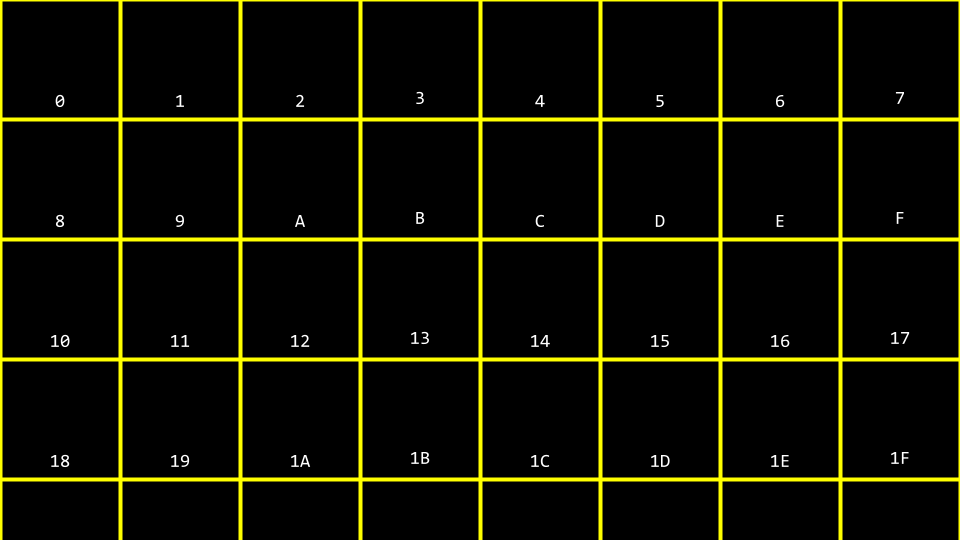

</div>
</div>


<div class="REY_BR5_NEGATIVE"></div>
<hr>
<div class="REY_BR5_NEGATIVE"></div>


<div style="display: flex; align-items: flex-start; gap: 20px;">
<div style="flex: ; text-align: center;">

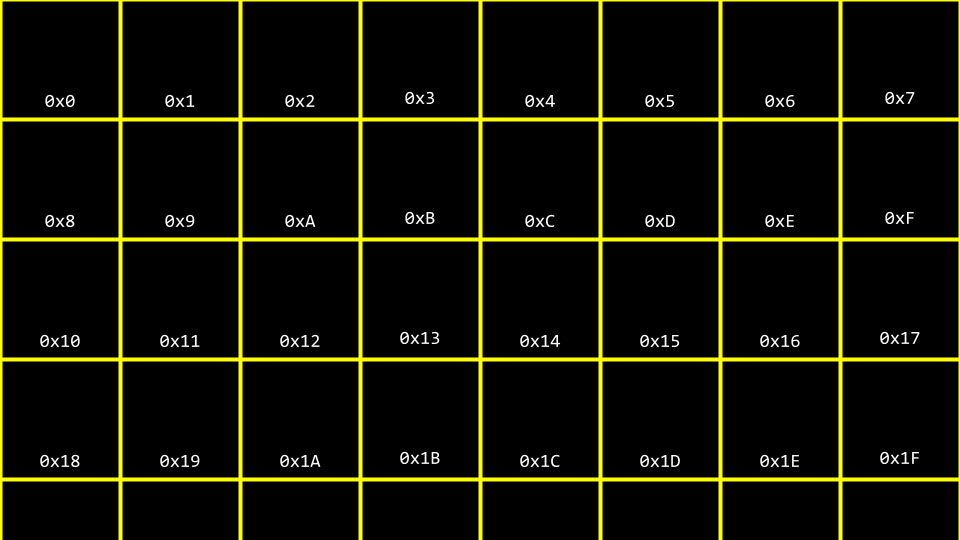

</div>
<div style="flex: 1;">
</br>
</br>

You can imagine how there may be confusion regarding:
- whether the memory-block labeled `10` in the first picture above 
    - may represent <u>a location in memory</u> or 
    - may represent the value 10. 

Accordingly, by convention, all hexadecimal numbers are often represented with the `0x` prefix as follows:
</div> 

</div>


<div class="REY_BR5_NEGATIVE"></div>
<hr>
<div class="REY_BR5_NEGATIVE"></div>


<div style="display: flex; align-items: flex-start; gap: 20px;">
<div style="flex: 1;">

```cpp
// Prints an integer
#include <stdio.h>

int main(void)
{
    int n = 50;
    printf("%i\n", n);
}
```
Notice how `n` is stored in memory with the value 50.
You can visualize how this program stores this value as follows

</div> 
<div style="flex: ; text-align: center;">

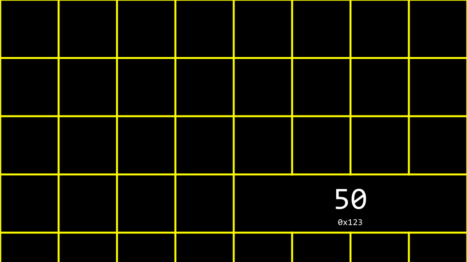

</div>
</div>


<div class="REY_BR5_NEGATIVE"></div>
<hr>
<div class="REY_BR5_NEGATIVE"></div>


<div style="display: flex; align-items: flex-start; gap: 20px;">
<div style="flex: ;">
</br>
</br>

Notice how `n` is stored in memory. 
- `value(n) = 50`
- `address(n) = 0x123`
    - There is a way we can Print this Address.

</div> 
<div style="flex: 1; text-align: center;">

```cpp
// Prints an integer's address
#include <stdio.h>

int main(void)
{
    int n = 50;
    printf("%p\n", &n);
}
```

</div>
</div>

</section>
</br>
</br>


<section class="REY_NO_PAGEBREAK">
</br>
<div style="margin-top: -30px;"></div>

## 3.2.1. Pointers
<div class="REY_BR5_NEGATIVE"></div>

The C language has <u>two powerful **operators**</u> that relate to memory:
- `&` - Provides the address of something stored in memory. [<b>this page</b>]
- `*` - Instructs the compiler to go to a location in memory. [<b>next page</b>]

<div style="display: flex; align-items: flex-start; gap: 20px;">
<div style="flex: 1; text-align: center;">

```cpp
// Prints an integer's address
#include <stdio.h>

int main(void)
{
    int n = 50;
    printf("%p\n", &n);
}
```

</div>
<div style="flex: ;">
</br>

`n` is stored in memory. 
- `value(n) = 50`
- `address(n) = 0x123`
    - There is a way we can Print this Address.
    - won't stay **"<u>invariant</u>"**, if we run it again.

</div>
</div>

Things to notice:
- `%p`, which allows us to view the address of a location in memory.
- `&n` can be literally translated as “<u>the address of n.</u>”
- `printf()` line prints the integer’s address.

Executing this code will print an address of memory beginning with `0x`


<div class="REY_BR5_NEGATIVE"></div>
<hr>
<div class="REY_BR5_NEGATIVE"></div>


> $\text{Def}^{\;n}$ 
> > A **"<u>pointer</u>"** is a variable that <u>stores the address</u> of something. 


<div class="REY_BR5_NEGATIVE"></div>
<hr>
<div class="REY_BR5_NEGATIVE"></div>


<div style="display: flex; align-items: flex-start; gap: 20px;">
<div style="flex: 1; text-align: center;">

```cpp
int  n = 50;
int *p = &n;
```
</div>
<div style="flex: 1;">
<div style="margin-top: -5px"></div>

`p` is a pointer that contains the <u>address of</u> an integer `n`
Here, `*` is not an "<u>operator</u>"
- wait a lil' bit before we get to that `*` "<u>operator</u>"

</div>
</div>


<div style="margin-top: -25px;"></div>
<hr>
<div class="REY_BR4_NEGATIVE"></div>


<div style="display: flex; align-items: flex-start; gap: 20px;">
<div style="flex: 1; text-align: ;">

```cpp
// Prints an integer's address
#include <stdio.h>

int main(void)
{
    int n = 50;

    printf("%p\n", &n);
}
```
- previous code

</div>
<div style="flex: 1;">

```cpp
// Stores and prints an integer's address
#include <stdio.h>

int main(void)
{
    int  n = 50;
    int *p = &n;
    printf("%p\n", p);
}
```
- modified new code ➡️ has the same effect

</div>
</div>
<div style="margin-top: -20px;"></div>

We have simply leveraged our new knowledge of the `&` operator.

<div class="REY_BR5_NEGATIVE"></div>
<hr>
<div class="REY_BR5_NEGATIVE"></div>


<div style="display: flex; align-items: flex-start; gap: 20px;">
<div style="flex: 1;">
</br>
</br>

Notice that the <u>**pointer**</u> seems <u>rather large</u>
- it looks double sized in the picture
- Indeed, a <u>pointer</u> is usually stored as an 8-byte value.
    - 8-byte = 64-bit
    - Why? ➡️ [🔗LinusTechTips](https://www.youtube.com/watch?v=IknbgnJLSRY)
    </br>
 
- maybe, by chance `p` ends up, here, sort of higher up on my slide

</div> 
<div style="flex: ; text-align: center;">

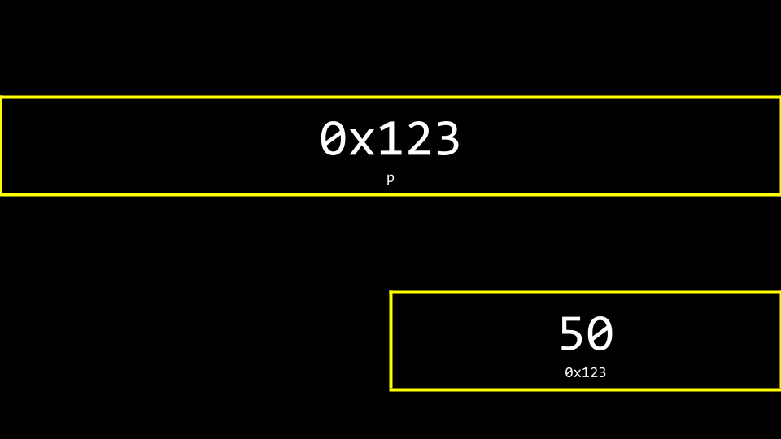

</div>
</div>


<div class="REY_BR5_NEGATIVE"></div>
<hr>
<div class="REY_BR5_NEGATIVE"></div>


<div style="display: flex; align-items: flex-start; gap: 20px;">
<div style="flex: ; text-align: center;">

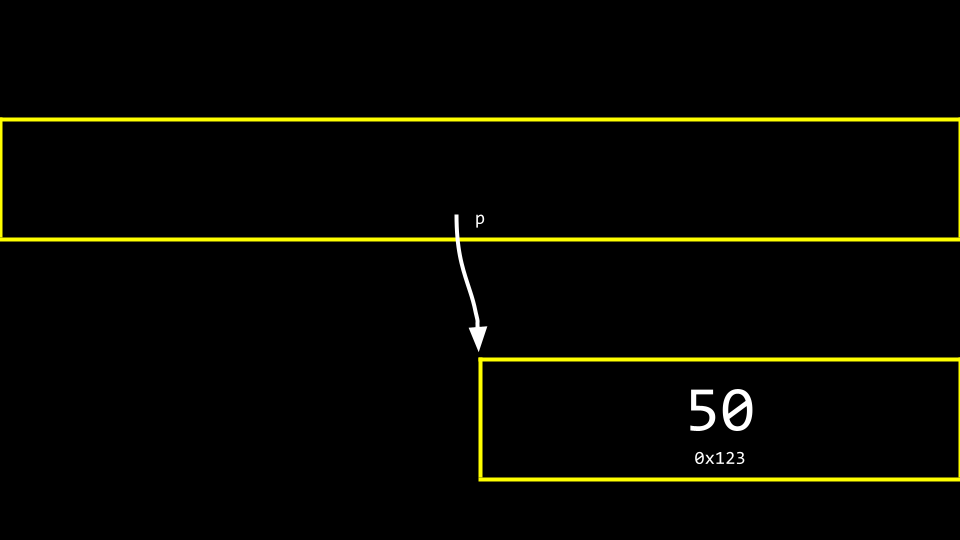

</div>
<div style="flex: 1;">
</br>
</br>
</br>

Modified New Code $ \iff $ Memory
- `int *p` creates a pointer 
    - whose job is to store the memory address of an integer. 
- `int *p` is a variable itself tho
    - var `p` is storing the <u>address of</u> var `n` 
    - var `p` is storing the <u>address of</u> the `50`

It is **Arcane**
It's a little weird

</div>
</div>

</section>
</br>
</br>
</br>


<section class="REY_NO_PAGEBREAK">
<div class="REY_NOSHOW_MD">
    </br>
    </br>
</div>

## 3.2.2. Pointers - `*` <u>Operator</u> - page1

<div class="REY_BR6_NEGATIVE"></div>
<div style="display: flex; align-items: flex-start; gap: 20px;">
<div style="flex: 1;">

So, What is `p`?
- it's just a variable
    - whose value <u>happens to be</u> an address

</div> 
<div style="flex: 1; text-align: ;">

So, What is `n`?
- it simply happens to be
    - an integer at that address

</div>
</div>


<div class="REY_BR5_NEGATIVE"></div>
<hr>
<div class="REY_BR5_NEGATIVE"></div>


<div style="display: flex; align-items: flex-start; gap: 20px;">
<div style="flex: 1;">
    <a href="https://www.youtube.com/watch?v=kcRdFGbzR1I&t=18m47s" target="_blank">
    
    </a>
</div>
<div style="flex: 1.8;">
<div style="margin-top: -15px;"></div>

[@18m47s][w4_1] [🔗][w4_1]➖➖ - <u>**Pointers**</u>
[@20m35s][w4_2] ➖➖[🔗][w4_2] - **"<u>Address Of</u>"** Operator `&` ➡️ `int *p = &n;`
[@22m13s][w4_3] [🔗][w4_3]➖➖ - Printing a Pointer ➡️ `0x7ffef2c2925c`
[@25m00s][w4_4] ➖➖[🔗][w4_4] - `int* p;` or `int *p;`?
[@26m00s][w4_5] [🔗][w4_5]➖➖ - **"<u>De-Reference</u>"** Operator `*`
[@27m45s][w4_6] ➖➖[🔗][w4_6] - <em style="font-size: 84%;"> The designers of $C$, decages ago, made an "unfortunate decision".... </em>
[@29m00s][w4_7] [🔗][w4_7]➖➖ - in terms of memory....
[@30m16s][w4_8] ➖➖[🔗][w4_8] - **<u>FAQ</u>**

[w4_1]: (https://www.youtube.com/watch?v=kcRdFGbzR1I&t=18m47s)
[w4_2]: (https://www.youtube.com/watch?v=kcRdFGbzR1I&t=20m35s)
[w4_3]: (https://www.youtube.com/watch?v=kcRdFGbzR1I&t=22m13s)
[w4_4]: (https://www.youtube.com/watch?v=kcRdFGbzR1I&t=25m00s)
[w4_5]: (https://www.youtube.com/watch?v=kcRdFGbzR1I&t=26m00s)
[w4_6]: (https://www.youtube.com/watch?v=kcRdFGbzR1I&t=27m45s)
[w4_7]: (https://www.youtube.com/watch?v=kcRdFGbzR1I&t=29m00s)
[w4_8]: (https://www.youtube.com/watch?v=kcRdFGbzR1I&t=30m16s)

</div>
</div>


<div class="REY_BR5_NEGATIVE"></div>
<hr>
<div class="REY_BR5_NEGATIVE"></div>

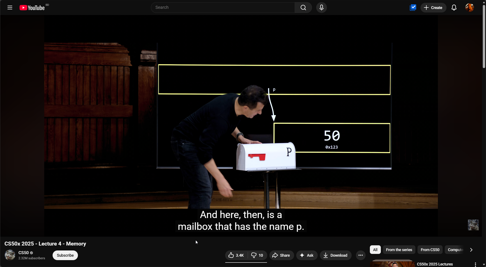
</br>


<div style="text-align: center; margin-top: -15px;">

[@33m00s](https://www.youtube.com/watch?v=kcRdFGbzR1I&t=33m00s) - little smth to not lose today's memory
### I, REYNEP, Highly recommend that you watch a few moments from here....

</div>

<div class="REY_BR5_NEGATIVE"></div>
<hr>
<div class="REY_BR5_NEGATIVE"></div>

</section>
</br>
</br>


<section class="REY_NO_PAGEBREAK">
</br>
</br>


## 3.2.2. Pointers - `*` <u>Operator</u> - page2

<div style="display: flex; align-items: flex-start; gap: 20px;">
<div style="flex: 1;">

```cpp
// prints an integer
#include <stdio.h>

int main(void)
{
  int  n = 50;

  printf("%i\n", n);    // we can change this line ➡️
}
```
1. how we normally print `int n;`

</div> 
<div style="flex: 1.4; text-align: ;">


```cpp
// prints an integer
#include <stdio.h>

int main(void)
{
  int  n = 50;
  int *p = &n;
  printf("%i\n", *p);
}
```
2. `*p` $\implies$ use the <u>location of `n`</u> called `p` ... and "<u>go there</u>", 
  i.e. <u>follow the breadcrumbs</u>

</div>
</div>


<div class="REY_BR5_NEGATIVE"></div>
<hr>
<div class="REY_BR5_NEGATIVE"></div>


<div style="display: flex; align-items: flex-start; gap: 20px;">
<div style="flex: 1;">

Two Operators
1. **"Address Of"** Operator `&`
2. **"De-Reference"** Operator `*`

</div> 
<div style="flex: 2.2; text-align: ;">

The designers of $C$, decages ago, made, I would say the "unfortunate decision", to use the `*` star in 3 different ways in total:
1. multiplication
2. **"De-Referencing"** ➡️`printf("%i\n", *p);`
3. **"Creating"** a pointer ➡️`int *p;`

</div>
</div>

<div class="REY_BR5_NEGATIVE"></div>
<hr>
<div class="REY_BR5_NEGATIVE"></div>

Admittedly Confusing, but
- `int *p = &n;` $\implies$ we are <u>declaring</u> a **"<u>pointer</u>"** & <u>assigning</u> it a memory-address
- `printf("%i\n", *p);` $\implies$ we are **"De-Referencing"** that pointer.
</br>

- one sort of "<u>creates</u>" the pointer
- one "<u>goes to</u>" that address


<div class="REY_BR5_NEGATIVE"></div>
<hr>
<div class="REY_BR5_NEGATIVE"></div>

</section>
</br>


<section class="REY_NO_PAGEBREAK">

Copying DAVID's Lines from [@26m00s][w4_5] [🔗][w4_5]➖➖ - **"<u>De-Reference</u>"** Operator `*`

> Well, 
> 1. I could print out `n` literally as I'm doing now.
> 2. Or, I could use the <u>location of `n`</u> called `p` .... and "<u>go there</u>" .... with the .... 2nd of these two operators
>     - The <u>**Dereference Operator**</u>.
>     - The    **Dereference Operator** - `*` means "<u>go to this address</u>"
>     - I'm kind of jumping through hoops proverbially here, because this is the stupid, longer, more complicated way to print out the value of 50, but it just speaks to the relative power that I have by just 1) <u>figuring out what the address is</u> and then 2) <u>going there</u>.
>     </br>


Copying DAVID's Lines from [@27m45s][w4_6] ➖➖[🔗][w4_6] - <em style="font-size: 84%;"> The designers of $C$, decages ago, made an "unfortunate decision".... </em>

> But the confusing part I do think about this for me and for most folks learning this is the following:
> - The designers of $C$, decages ago, made, I would say the "unfortunate decision", to use the `*` star in 3 different ways in total:
>     1. multiplication
>     2. `printf("%i\n", *p);` ➡️ here it literally means "<u>go there</u>"
>         - i.e. **"<u>DeReference</u>"** the address
>         - i.e. <u>follow the breadcrumbs</u>, and <u>go there</u>.
>     3. `int *p;`
>         - But, when you declare the pointer
>         - when you create the pointer
>             - you also use a `*` but
>             - you also use the `type`.
>             </br>
>             </br>
>  
> - So, what's confusing at least to me, is, we are using the `*` in two different ways
>     - both of which are related to addresses,
>     - both of which are related to pointers
>  
> 1. But, when you create a variable or declare a variable for the first time, 
>     - `int *p;`
>         -  you specify not only `*`
>         -  but the `type` of the pointer (just like any other variable declaration)
> 2. But, when you use the pointer subsequently, 
>     - `printf("%i\n", *p);`
>         - you do not mention the data type again.
>         - The compiler is smart enough to "<u>remember</u>"
>             - "okay, got it. you wanted a pointer to an integer." from the line
>                 - `int *p;`

</section>
</br>
</br>


<div class="REY_NOSHOW_PDF">

-------------------------------------------------------------------
<div align=center style="font-size: 50px; font-family: 'Iosevka Curly'; ">Page-Break</div>
</div>
<div class="REY_PAGEBREAK"></div>
<div class="REY_NOSHOW_PDF">

-------------------------------------------------------------------
</div>


<section class="REY_NO_PAGEBREAK">
</br>
</br>
</br>

## 3.2.3. String

<div style="display: flex; align-items: flex-start; gap: 20px;">
<div style="flex: 1;">

```cpp
// Prints a string
#include <cs50.h>
#include <stdio.h>

int main(void)
{
  string s = "HI!";  // comes from <cs50.h>
  printf("%s\n", s);
}
```

</div>
<div style="flex: ; text-align: center;">
</br>
</br>
</br>

Now that we have a mental model for pointers, we can peel back a level of simplification that was offered earlier in this course.

</div>
</div>


<div style="display: flex; align-items: flex-start; gap: 20px;">
<div style="flex: 1;">
</br>
</br>
</br>
</br>

Recall that a <u>**string**</u> is simply <u>an **"array"** of **characters**</u>. 
- For example, `string s = "HI!"` can be represented as follows:
    </br>
- The idea of **"<u>array</u>"** will be introduced later...

</div> 
<div style="flex: ; text-align: center;">

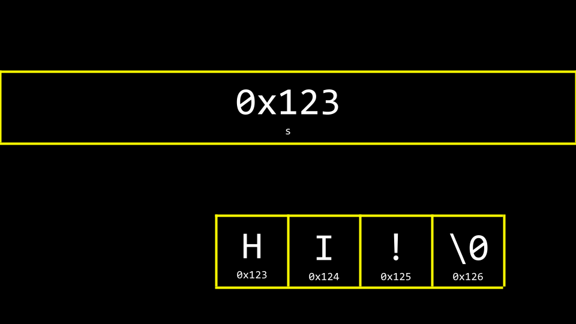

</div>
</div>
<div style="margin-top: 10px;"></div>


<div style="display: flex; align-items: flex-start; gap: 20px;">
<div style="flex: ; text-align: center;">

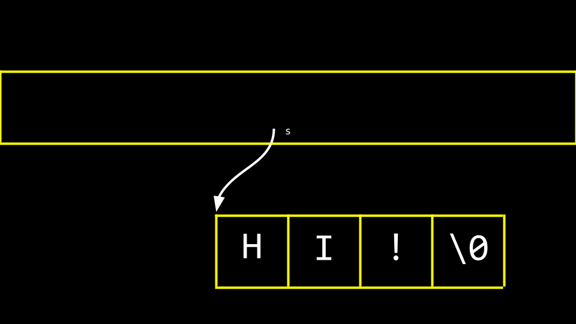

</div>
<div style="flex: 1;">
</br>
</br>
</br>

However, what is `s` really?
- You can visualize the relationship of the variable `s` to the `string` as the following piece of memory:

Notice 
- how a <u>**pointer**</u> called `s` tells the **compiler** where the <u>first byte</u> of the <u>**string**</u> exists in memory

</div>
</div>


<div class="REY_BR5_NEGATIVE"></div>
<hr>
<div class="REY_BR5_NEGATIVE"></div>


<div style="display: flex; align-items: flex-start; gap: 20px;">
<div style="flex: 0.7;">
</br>
</br>

The idea of **"<u>array</u>"** will be introduced later...
- but the key idea is
    - `s[0]` $\coloneqq char_0$ `= 'H'`
    - `s[1]` $\coloneqq char_1$ `= 'I'`
    - `s[2]` $\coloneqq char_2$ `= '!'`& so on
    - in CS, we love to start from `0`


</div>
<div style="flex: 1; text-align: ;">

```cpp
// Prints each character of a string
#include <cs50.h>
#include <stdio.h>

int main(void)
{
    string s = "HI!";
    char k0 = s[0];     printf("%c\n", k0);     // outputs: H  
    char k1 = s[1];     printf("%c\n", k1);     // outputs: I
    char k2 = s[2];     printf("%c\n", k2);     // outputs: !
    char k3 = s[3];     printf("%c\n", k3);     // outputs: 
}
```

</div>
</div>


<div style="display: flex; align-items: flex-start; gap: 20px;">
<div style="flex: 1;">

```cpp
// Prints a string's address 
    // as well the addresses of its chars
#include <cs50.h>
#include <stdio.h>

int main(void)
{
    string s = "HI!";
    printf("%p\n", s);
    printf("%p\n", &s[0]);
    printf("%p\n", &s[1]);
    printf("%p\n", &s[2]);
    printf("%p\n", &s[3]);
}
```

</div>
<div style="flex: ; text-align: ;">
</br>
</br>

This code
- prints the <u>memory locations</u> of <u>**each**</u> <u>character</u> in the `string s`. 
- The `&` symbol is used <u>to show the address of each element</u> of the <u>**string**</u>. 
  </br>
- When running this code, & looking @ the output, notice that 
    - elements 0, 1, 2, and 3 of the string
    - a.k.a. `s[0]`, `s[1]`, `s[2]`, `s[3]` are next to one another in memory.

</div>
</div>

<div class="REY_BR5_NEGATIVE"></div>
<hr>
<div class="REY_BR5_NEGATIVE"></div>

</section>


<section class="REY_NO_PAGEBREAK">

</br>
<div class="REY_NOSHOW_MD">
    </br>
    </br>
    </br>
    </br>
    </br>
    </br>
    </br>
    </br>
    </br>
    </br>
</div>

## 3.2.4. `char *str`

<div style="display: flex; align-items: flex-start; gap: 20px;">
<div style="flex: 1;">

```cpp
// Declares a string with CS50 Library
#include <cs50.h>
#include <stdio.h>

int main(void)
{
    string s = "HI!";
    printf("%s\n", s);
}
```
1. using the $cs50$ training wheel `string`

</div>
<div style="flex: ;">

```cpp
// Declares a string without CS50 Library

#include <stdio.h>

int main(void)
{
    char *s = "HI!";
    printf("%s\n", s);
}
```
2. `cs50.h` is removed. `string` = `char *`
    - `char *c` will represent the <u>**string**</u> that starts at the location of `s`. 
    - `char *c` 
        - is raw $C$ code, 
        - is without the scaffolding of the $cs50$ library. 
        - effectively removes the training-wheels of the `string` data type offered by `cs50.h`. 

</div>
</div>

</section>
</br>
</br>
</br>


<section class="REY_NO_PAGEBREAK">

## 3.2.5. String - <u>Pointer Arithmetic</u>

<div style="display: flex; align-items: flex-start; gap: 20px;">
<div style="flex: 2;">

```cpp
// Prints each character of a string
#include <stdio.h>

int main(void)
{
    char *s = "HI!";
    char k0 = s[0];     printf("%c\n", k0);     // outputs: H  
    char k1 = s[1];     printf("%c\n", k1);     // outputs: I
    char k2 = s[2];     printf("%c\n", k2);     // outputs: !
    char k3 = s[3];     printf("%c\n", k3);     // outputs: 
}
```

</div>
<div style="flex: 2;">

```cpp
// Prints a string's chars
#include <stdio.h>

int main(void)
{
    char *s = "HI!";
    printf("%c\n", s[0]);   // same effect
    printf("%c\n", s[1]);
    printf("%c\n", s[2]);
    printf("%c\n", s[3]);
}
```

</div>
</div>


<div style="display: flex; align-items: flex-start; gap: 20px;">
<div style="flex: 1;">

```cpp
// Prints a string's chars
#include <stdio.h>

int main(void)
{
    char *s = "HI!";
    printf("%c\n", s[0]);
    printf("%c\n", s[1]);
    printf("%c\n", s[2]);
}
```
1. printing each `char` @ `s`

</div>
<div style="flex: 2;">

```cpp
// Prints a string's chars via pointer arithmetic
#include <stdio.h>

int main(void)
{
    char *s = "HI!";
    printf("%c\n", *s);
    printf("%c\n", *(s + 1));       // Pointer Arithmetic
    printf("%c\n", *(s + 2));       // Eventually having the same effect
}
```
2. Notice that 
    1. the $1^{st}$ character at the <u>location of</u> `s` is printed.
    2. Then, the character at the <u>location</u> `s + 1` is printed, and so on. 
    3. effectly having the <u>same effect</u> as the code on the left

</div>
</div>

</section>


<div class="REY_NOSHOW_PDF">

-------------------------------------------------------------------
<div align=center style="font-size: 50px; font-family: 'Iosevka Curly'; ">Page-Break</div>
</div>
<div class="REY_PAGEBREAK"></div>
<div class="REY_NOSHOW_PDF">

-------------------------------------------------------------------
</div>


<section class="REY_NO_PAGEBREAK">

</br>
<div class="REY_NOSHOW_MD">
    </br>
    </br>
</div>

## 3.2.6. Loops


<div style="display: flex; align-items: flex-start; gap: 20px;">
<div style="flex: 0.73;">

```cpp
#include <stdio.h>

int main(void)
{
    printf("meow\n");
    printf("meow\n");
    printf("meow\n");
}
```

</div>
<div style="flex: ;">
    <div style="margin-top: 4px;"></div>
    <a href="https://www.youtube.com/watch?v=89cbCbWrM4U&t=1h23m26s)" target="_blank">
    
    </a>
</div>
<div style="flex: ;">
<div style="margin-top: -15px;"></div>

</br>
</br>
</br>
</br>

[@1h23m26s](https://www.youtube.com/watch?v=89cbCbWrM4U&t=1h23m26s) - Loops

</div>
</div>


<div style="display: flex; align-items: flex-start; gap: 20px;">
<div style="flex: 0.78;">

```cpp
#include <stdio.h>

int main(void)          // Code with Same Effect
{
    int i = 1;
    while (i <= 3)
    {
        printf("meow\n");
        i = i+1;
    }
}
```

</div>
<div style="flex: ;">

</br>
</br>
</br>
</br>
</br>

- `i = i+1` $\coloneqq$ Every time `1` is added to `i`
    - Once `i` is greater than 3, it will stop the loop. 

</div>
</div>


<div style="display: flex; align-items: flex-start; gap: 20px;">
<div style="flex: 1;">

<div style="margin-top: 25px;"></div>

```cpp
int i = 1;
while (i <= 3)
{
    printf("meow\n");
    i = i+1;
}
```

</div>
<div style="flex: 2;">

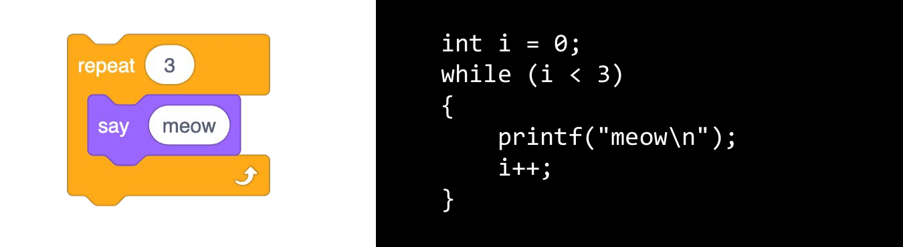

</div>
</div>


<div style="display: flex; align-items: flex-start; gap: 20px;">
<div style="flex: 1;">

<div style="margin-top: 25px;"></div>

```cpp
int i = 0;
while (i < 3)
{
    printf("meow\n");
    i++;
}
```

</div>
<div style="flex: 2;">

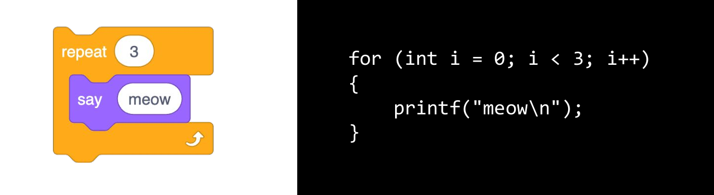
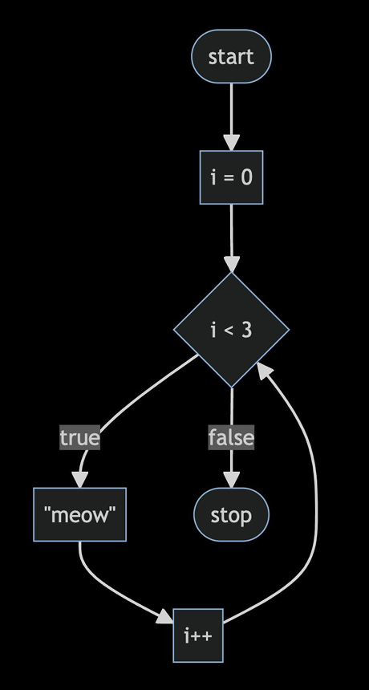

</div>
</div>


<div class="REY_BR5_NEGATIVE"></div>
<hr>
<div class="REY_BR5_NEGATIVE"></div>


## 3.2.6. Loops - Summary

<div style="display: flex; align-items: flex-start; gap: 20px;">
<div style="flex: 1;">


1. repeats 3 times

```cpp
int n = 3;      // also we could have a variable like this

for (int i = 0; i < n; i++)     // that plug that in here
{
    printf("meow\n");
}
```

</div>
<div style="flex: 1;">

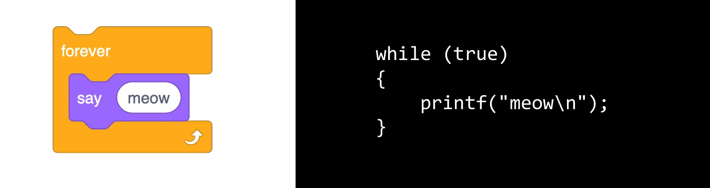

1. repeats forever

</div>
</div>

</section>

<div class="REY_NOSHOW_PDF">

-------------------------------------------------------------------
<div align=center style="font-size: 50px; font-family: 'Iosevka Curly'; ">Page-Break</div>
</div>
<div class="REY_PAGEBREAK"></div>
<div class="REY_NOSHOW_PDF">

-------------------------------------------------------------------
</div>


</br>
<section class="REY_NO_PAGEBREAK">

## 3.2.7. Functions


<div style="display: flex; align-items: flex-start; gap: 20px;">
<div style="flex: 1;">

1. These two <u>left-images together</u>
    - "no input"
    - "no output"


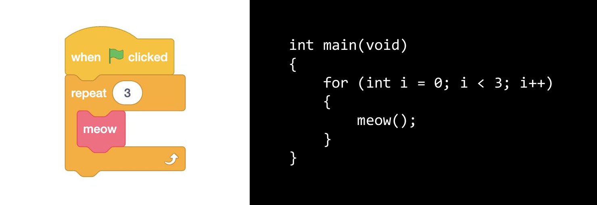

</div>
<div style="flex: 1;">

1. These two <u>right-images together</u>
    - `int n` input
    - "no output" 

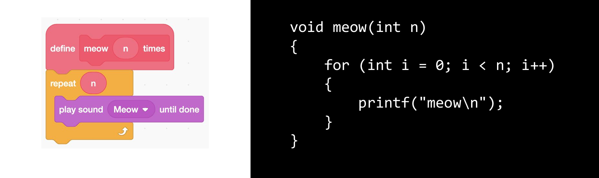


</div>
</div>


<div style="display: flex; align-items: flex-start; gap: 20px;">
<div style="flex: 1;">

```cpp
#include <stdio.h>

// Meow once
void meow(void)
{
    printf("meow\n");
}


int main(void)
{
    for (int i = 0; i < 3; i++)
    {
        meow();
    }
}
```


</div>
<div style="flex: 1;">

```cpp
#include <stdio.h>

// Meow some number of times
void meow(int n)
{
    for (int i = 0; i < n; i++)
    {
        printf("meow\n");
    }
}


int main(void)
{
    meow(3);
}
```

</div>
</div>


<div style="display: flex; align-items: flex-start; gap: 20px;">
<div style="flex: 1;">

Printing
- is <b><u>not</u></b> an "output" from the perspective of **"<u>functions</u>"**.
- is an "output" from the perspective of user & the terminal

</div>
<div style="flex: 1;">

**"<u>Functions</u>"**
- inputs are called **"<u>parameters</u>"** -- can be multiple inputs
- output is called **"<u>return value</u>"** -- must return only 1 thing.

</div>
</div>


<div class="REY_BR5_NEGATIVE"></div>
<hr>
<div class="REY_BR5_NEGATIVE"></div>

<div style="display: flex; align-items: flex-start; gap: 20px;">
<div style="flex: 0.73;">

</br>

- Why do functions need inputs?
    ```cpp
    int main(void) {
        int k = 10;
    }

    int func(void) {
        printf("%d", k); printf("\n");
    }
    ```
    - Because, this code won't compile....
    - `k` is not accessible outside `main`


</div>
<div style="flex: ;">
    <div style="margin-top: 4px;"></div>
    <a href="https://www.youtube.com/watch?v=89cbCbWrM4U&t=1h23m26s)" target="_blank">
    
    </a>
</div>
<div style="flex: ; text-align: center;">

</br>
</br>
</br>
</br>
</br>

[@1h34m37s](https://www.youtube.com/watch?v=89cbCbWrM4U&t=1h34m37s)
Functions

</div>
</div>

<div class="REY_BR5_NEGATIVE"></div>
<hr>
<div class="REY_BR5_NEGATIVE"></div>


<div style="display: flex; align-items: flex-start; gap: 20px;">
<div style="flex: 1;">

```cpp
// Meow some number of times
void meow(int n)
{
    for (int i = 0; i < n; i++)
    {
        printf("meow\n");
    }
}
```

</div>
<div style="flex: 1;">

```cpp
// Get number of meows
int get_positive_int(void)
{
    int n = -1;
    while (true)
    {
        n = get_int("Number: ");
        if (n > 1) {
            break;      // break the look
        }
    }
    return n;
}
```

</div>
</div>


```cpp
#include <cs50.h>
#include <stdio.h>

int main(void) {
    int n = get_positive_int();
    meow(n);
}
```

<div class="REY_BR5_NEGATIVE"></div>
<hr>
<div class="REY_BR5_NEGATIVE"></div>

</section>


<div class="REY_NOSHOW_PDF">

-------------------------------------------------------------------
<div align=center style="font-size: 50px; font-family: 'Iosevka Curly'; ">Page-Break</div>
</div>
<div class="REY_PAGEBREAK"></div>
<div class="REY_NOSHOW_PDF">

-------------------------------------------------------------------
</div>


<section class="REY_NO_PAGEBREAK">

</br>
<div class="REY_NOSHOW_MD">
    </br>
    </br>
    </br>
    </br>
</div>

## 3.2.8. Swapping

<div style="display: flex; align-items: flex-start; gap: 15px;">
<div style="flex: 1;">

<div style="flex: ;">
    <div style="margin-top: 4px;"></div>
    <a href="https://www.youtube.com/watch?v=kcRdFGbzR1I&t=1h39m00s)" target="_blank">
    
    </a>
</div>

</div>
<div style="flex: ;">

In the real world 
- a common need in programming is to <u>swap two values</u>. 
- Naturally, <u>it’s hard to swap</u> two variables <u>without a temporary holding space</u>. 
- In practice, you can type code `swap.c` and write code as follows to see this in action:

[@1h39m00s](https://www.youtube.com/watch?v=kcRdFGbzR1I&t=1h39m00s)
**swapping**

</div>
</div>


</br>
</br>
</br>

The Problem

<div style="display: flex; align-items: flex-start; gap: 20px;">
<div style="flex: 1;">

```cpp
// Fails to swap two integers
#include <stdio.h>

void swap(int a, int b)
{
    int tmp = a;
    a = b;
    b = tmp;
}

int main(void)
{
    int x = 1;
    int y = 2;

    printf("x is %i, y is %i\n", x, y);
    swap(x, y);
    printf("x is %i, y is %i\n", x, y);
}
```

</div>
<div style="flex: ;">

```cpp
output
    x is 1, y is 2
    x is 1, y is 2
```

Notice that 
- while this code runs, <u>it does not work</u>. 
- The values, even after being sent to the **swap()** function, <u>do not swap</u>. **<u>Why?</u>**

When you <u>pass values</u> to a function,
- <u>you are only providing copies.</u>
- In our code above, `x` and `y` are being passed by value.
    - whenever, this is done, values(`x` & `y`) are getting copied into `a` & `b`

Two Different Functions
- `main` and `swap`, in terms of memory, 
    - have <u>two separate</u> frames or <u>areas of memory</u>.

</div>
</div>
</br>


<div style="display: flex; align-items: flex-start; gap: 10px;">
<div style="flex: 1.37;">
    <div style="display: flex; align-items: flex-start; gap: 10px;">
        <div style="flex: 1;">
            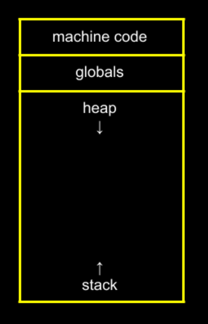
        </div>
        <div style="flex: 1;">
            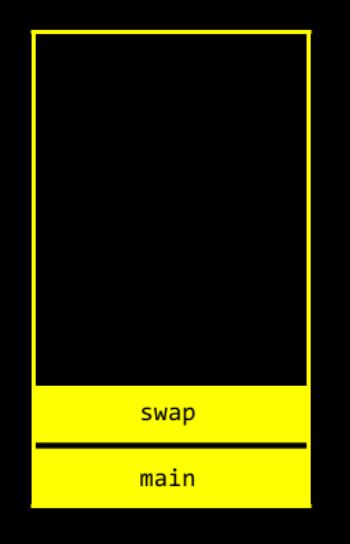
        </div>
    </div>

Image 1
- executed the first 3 lines of `main()`

Image 2
- line 4 of `main()` $\implies$ `swap(x, y);`
- `swap(x, y)` has been called
    - so we must go inside this function
    - and execute code line by line
    - we executed line 1 inside `swap()`

Image 3
- line 2 inside `swap` ➡️ update `a`
- line 3 inside `swap` ➡️ update `b`
- no more code inside swap, the end
    - so we `return`

Image 4
- Even tho, `a` & `b` might have been <u>swapped</u>
- `x`, `y` was not changed 💁‍♀️

</div>
<div style="flex: 2;">
    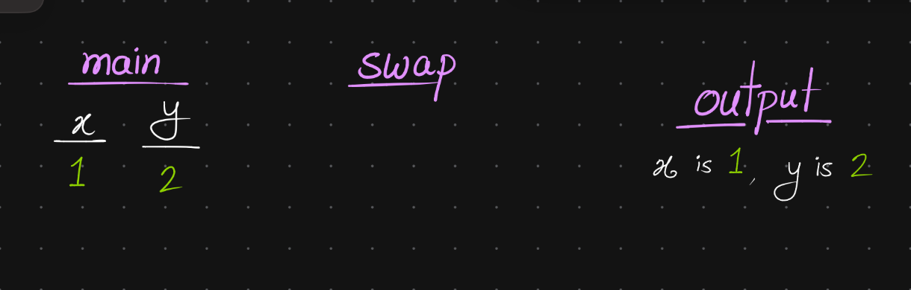
    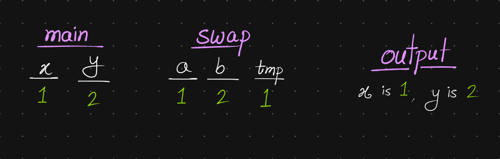
    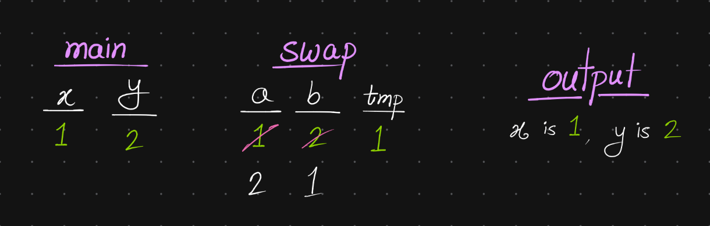
    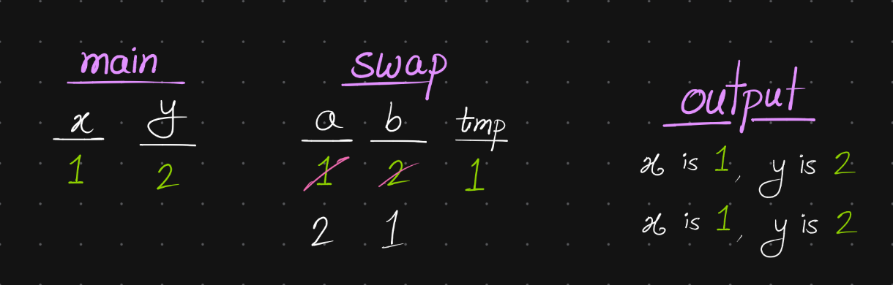
</div>
</div>
</section>
</br>
</br>


<section class="REY_NO_PAGEBREAK">

<div class="REY_NOSHOW_MD">
    </br>
    <div style="margin-top: -35px;"></div>
</div>

## 3.2.8. Swapping
<div class="REY_BR3_NEGATIVE"></div>

The Solution

<div style="display: flex; align-items: flex-start; gap: 10px; margin-left: -20px; margin-right: -20px;">
<div style="flex: 0.5;">

```cpp
// Swaps two integers using pointers
#include <stdio.h>

void swap(int *a, int *b)
{
    int tmp = *a;
    *a = *b;
    *b = tmp;
}

int main(void)
{
    int x = 1;
    int y = 2;

    printf("x is %i, y is %i\n", x, y);
    swap(&x, &y);
    printf("x is %i, y is %i\n", x, y);
}
```

</div>
<div style="flex: 1;">


<div style="display: flex; align-items: flex-start; gap: 10px;">
<div style="flex: ;">
</br>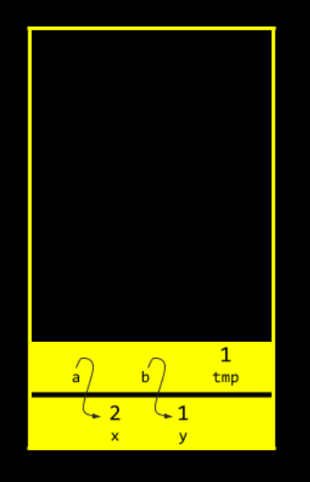
</div>
<div style="flex: 1;">

</br>
</br>
</br>
Don't Get Confused!
</br>
</br>

Remember, 
The designers of $C$,  decages ago, made, 
an "<u>unfortunate decision</u>":

<div style="margin-top: 15px;"></div>

- Star `*` is used in 3 different ways in total:
    1. <b>multiplication</b>
    2. <b>De-Referencing</b> ➡️`printf("%i\n", *p);`
    3. <b>Creating a pointer</b> ➡️`int *p;`

</div>
</div>

</div>
</div>


<div style="display: flex; align-items: flex-start; gap: 10px;">
<div style="flex: ;">

```cpp
void swap(int *a, int *b)
```
- `int *a` ➡️ **"Creating"** a pointer
 
```cpp
int tmp = *a;
```
- `*a` ➡️ **"De-Referencing"** a pointer

```cpp
*a = *b;
```
- `*a` ➡️ "<u>follow the breadcrumbs</u>", go to that address, <u><b>save</b> value in</u> there
- `*b` ➡️ "<u>follow the breadcrumbs</u>", go to that address, <u><b>grab</b> value from</u> there

</div>
<div style="flex: ;">

This is called,
- "<u>passing value by reference</u>"
    - That is
        - instead of copying values(`x` & `y`)
        - the addresses of `x` and `y` 
          are provided to the function
    - And
        - if we know the address
        - we can just "go there" & poke around


</div>
</div>

</section>


<section class="REY_NO_PAGEBREAK">

## 3.2.9. the `scanf()` function

```cpp
// Gets an int from user using scanf
#include <stdio.h>

int main(void)
{
    printf("Enter a Number (n): ");
        int n;
        scanf("%i", &n);
            // %i ==> scanf() will expect an integer
            // &n ==> scanf() will store the integer @ the address "&n"
            //  n ==> is not a address, it's a variable
            // &n ==> is the actual address

    printf("n: %i\n", n);
}
```
Now, if you understood, why the <u>swapping function</u> needs address of `x` and `y`, then you could guess, why `scanf()` also needs address.


<div class="REY_BR5_NEGATIVE"></div>
<hr>
<div class="REY_BR5_NEGATIVE"></div>

<div style="display: flex; align-items: flex-start; gap:10px;">
<!-- ============= 1 ============= -->
<div style="flex: ;">

```cpp
int m, n;
float x, y;
scanf("%d %d %f %f", &m, &n, &x, &y);
```

```cpp
1 -20 .3 -4.0e3
  // Say, the user writes this line and hits enter
  // Then
        m = 1       x = 0.3
        n = -20     y = -4000.0
```

</div> 
<!-- ============= 1 ============= -->
<div style="flex: ;">
    <div style="margin-top: 3px;"></div>
    <a href="https://www.youtube.com/watch?v=kcRdFGbzR1I&t=2h01m24s)" target="_blank">
    
    </a>
</div>
<div style="flex: ; text-align: center;">

</br>
</br>
</br>
</br>

[@2h01m24s](https://www.youtube.com/watch?v=kcRdFGbzR1I&t=2h01m24s)
**scanf()**

</div>
</div>

<div class="REY_BR5_NEGATIVE"></div>
<hr>
<div class="REY_BR4_NEGATIVE"></div>
<div style="margin-top: -35px;"></div>


<div style="display: flex; align-items: flex-start; gap:10px;">
<!-- ============= 1 ============= -->
<div style="flex: 1;">

```cpp
#include <stdio.h>

int main(void) {
    char *s;    // buggy
    printf("s: ");
    scanf("%s", s);
    printf("s: %s\n", s);
}
```
1. `s` points to a <u>different address</u> everytime you run it

</div> 
<!-- ============= 1 ============= -->

<div style="flex: 1.2; text-align: ;">

```cpp
#include <stdio.h>

int main(void) {
    char s[4];  // fixed (somewhat)
    printf("s: ");
    scanf("%s", s);
    printf("s: %s\n", s);
}
```
2. `s` is still a pointer. `s` now points to an `char` <u>**array**</u> of size `4`
    - we can input `cat` and the program functions. 
    - However, an <u>input larger</u> than this could create an <u>error</u>.
        - so, `char s[1024];` or more could be done

</div>
</div>


</section>


<div class="REY_NOSHOW_PDF">

-------------------------------------------------------------------
<div align=center style="font-size: 50px; font-family: 'Iosevka Curly'; ">Page-Break</div>
</div>
<div class="REY_PAGEBREAK"></div>
<div class="REY_NOSHOW_PDF">

-------------------------------------------------------------------
</div>


<section class="S1">
<div class="REY_NOSHOW_MD">
    </br>
    </br>
    </br>
    </br>
    </br>
    </br>
    </br>
    </br>
    </br>
    </br>
    </br>
    </br>
    </br>
    </br>
</div>

## 3.2.10. `scanf()` - ivans lines 🟩


<div style="display: flex; align-items: flex-start; gap: 15px; margin-left: -20px; margin-right: -20px;">
<div style="flex: 1;">

Recall that
- `printf()` prints output according to a <u>really specific <b>format string</b></u>
- `printf()` prints output according to a <u>specified format</u>

Just the Same way
- ==`scanf()` reads input according to a <u>particular format</u> too.== 
    - so `scanf()` takes in a <b>format string</b></u> too.
    - The conversions allowed with `scanf()` are essentially the same as those used with `printf()`.
    - ==A `scanf()` <b>format string</b> may contain both <u>ordinary characters</u> and <u>conversion specifications</u>.== 

</div>
<div style="flex: ;">

<u><b>format string</b></u> consists of:
- <b>ordinary characters</b>
- <b>conversion specifications</b>

</div>
</div>


<div class="REY_BR5_NEGATIVE"></div>
<hr>
<div class="REY_BR5_NEGATIVE"></div>

<div style="display: flex; align-items: flex-start; gap: 15px; ">
<div style="flex: 1;">

```cpp
int m, n;
float x, y;
scanf("%d %d %f %f", &m, &n, &x, &y);
```

```cpp
1 -20 .3 -4.0e3
```

<div class="REY_SMALLER_BLOCK" style="font-size: 70%; line-height: 1.2;">

- (then up next, <b>ivan</b> showed this code & didn't even bother to write any text)
- <b>ivan</b> also called this input above, "output"

</div>

</div>
<div style="flex: ;">

In many cases
- a `scanf()` <b>format string</b> will contain only these <u>conversion specifications</u>, as in the following example:

Suppose that the user enters the following input line:
and then presses enter.
- `scanf()` will read the line
- converting its characters to the numbers they represent, 
- and then 
    - <b>assign</b> `1`, `–20`, `0.3`, and `–4000.0` 
    - to `m`, `n`, `x`, and `y`, respectively.

</div>
</div>

<div class="REY_BR5_NEGATIVE"></div>
<hr>
<div class="REY_BR5_NEGATIVE"></div>


<div style="display: flex; align-items: flex-start; gap: 15px; ">
<div style="flex: 1;">

```cpp
scanf("%d %d %f %f", &m, &n, &x, &y);
scanf("%d%d%f%f", &m, &n, &x, &y);
```

</div>
<div style="flex: ;">

Note that
- both line here, would have had the same effect. 
    - “Tightly packed” <b>format strings</b> like `"%d%d%f%f"` are common in `scanf()` calls.

</div>
</div>

</section>


</br>
</br>
<section class="REY_NO_PAGEBREAK" style="margin-left: -10px;">

## 3.2.11. `scanf()` traps 🟩 (unedited)
`scanf()` & `printf()` contains several traps for the unwary. ==When using them, the programmer must check that:==

<div style="margin-top: 10px"></div>

1. 🟩 <u>the number of</u> <b>conversion specifications</b> matches <u>the number of</u> <b>input variables</b> 
2. 🟩 <b>each conversion</b> is <u>appropriate</u> for the <u>corresponding variable</u>
    - the compiler isn’t required to check for a possible mismatch.
    </br>

3. 🟩 Another trap for `scanf()` involves the `&` symbol
    - `&` normally precedes each variable in a `scanf()` call.
    - The `&` is usually (but not always) required, and it’s the programmer’s responsibility to remember to use it.

</section>
</br>


<section class="REY_NO_PAGEBREAK">
    </br>
    </br>
    </br>
    <div class="REY_NOSHOW_MD">
        </br>
        </br>
        </br>
        </br>
        </br>
        </br>
        </br>
    </div>

## 3.2.12. How `scanf()` works 🟩 (unedited)

Uhem,
- `scanf()` can actually do much more than I’ve indicated so far. 
- `scanf()` ==is essentially a <b>“pattern-matching”</b> function== 
    - ==that tries to match up groups of input characters with <u>conversion specifications</u> in a <u>format-string</u>==
    </br>

- `scanf()` & `printf()` is controlled by the <u>format string</u>. 
</br>


When `scanf()` is called, 
- `scanf()` begins processing the information in the string, starting at the left.
</br>
<div class="REY_BR4_NEGATIVE"></div>

- 🟩 For each <b>conversion specification</b> in the <u>format string</u>
    - `scanf()` tries to locate an item of the appropriate type in the input data, 
        - <u>skipping blank space</u> if necessary.
        </br> 
    - `scanf()` then reads the item
        - <u>stopping when</u> it encounters a character that can’t possibly belong to the item.
        </br>
    - If the item was read successfully, 
        - `scanf()` continues processing the rest of the format string.
    - If any item is not read successfully, 
        - `scanf()` returns immediately 
            - without looking at the rest of the format string (or the remaining input data). 
            </br>
            </br>

    - As `scanf()` searches for the beginning of a number, it <u><b>ignores</b> **white-space characters**</u> 

        <div class="REY_BR5_NEGATIVE"></div>
        <hr style="margin-bottom: 38px;">
        <div class="REY_BR4_NEGATIVE"></div>

        - Remember, <b>white-space characters</b> 
            - ` ` - **ASCII 32** - <b>space</b> 
            - `\n` - **ASCII 10** - <b>newline</b> - Moves cursor to the beginning of the <u>next line</u>
            - `\t` - **ASCII 9** - <b>horizontal tab</b>
            - `\v` - **ASCII 11** - <b>vertical tab</b>
            - `\f` - **ASCII 12** - <b>form feed</b> - Advances the output to the next page or form
            - `\r` - **ASCII 13** - <b>carriage return</b> - Moves cursor to the beginning of the <u>current line</u>
            </br>

        <div class="REY_BR3_NEGATIVE"></div>
        <hr>
        <div class="REY_BR5_NEGATIVE"></div>

        - As a result, numbers can be put on a single line or spread out over several lines. 
          Consider the following call of `scanf()`:
            ```cpp
            scanf("%d%d%f%f", &i, &j, &x, &y);
            ```
            </br>
            <div style="display: flex; align-items: flex-start; gap: 20px;">
            <div style="flex: 1;">

            Suppose that the user enters three lines of input:
            ```cpp
            1
            -20   .3
            -4.0e3
            ```

            </div>
            <div style="flex: 1.25;">

            `scanf()` sees one continuous stream of characters:
            ```cpp
            ••1¤-20•••.3¤•••-4.0e3¤
            ```
            - Author's using `•` to represent <u>space</u> and `¤` to represent the <u>new-line</u>.


            </br>


            ```cpp
            ••1¤-20•••.3¤•••-4.0e3¤
            ssrsrrrsssrrssssrrrrrr
            ```
            - `s` under a character indicates that it was skipped
            - `r` indicates it was read as part of an input item

            </div>
            </div>
            </br>
            </br>

            - 🎴 `scanf()` <b>“peeks”</b> at the final <b>new-line</b> character without actually reading it. 
            - 🎴 This <u><b>new-line</b> will be the first character read by the next call</u> of `scanf()`.

</br>
</br>
</br>
</br>
</br>
</section>


<section class="REY_NO_PAGEBREAK">
    <div class="REY_NOSHOW_MD">
        </br>
        <div style="margin-top: -20px;"></div>
    </div>

## 3.2.13. How `scanf()` works - II - 🟩 (unedited)

What rules does `scanf()` follow to recognize an `int` or `float`? 
</br><div class="REY_BR4_NEGATIVE"></div>

- 🟩 When asked to read an `int`
    - `scanf()` first searches for 
        - a digit, or
        - a plus sign, or 
        - a minus sign; 
    - it then 
        - keeps on reading digits <u>until it reaches a non-digit</u>. 
    </br>

- 🟩 When asked to read a `float` 
    - `scanf()` first looks for 
        - a digit, or
        - a plus sign, or 
        - a minus sign; 
    - followed by
        - more digits, or,
        - decimal point + more digits 
    - followed by
        - an exponent (optional).
        - a.k.a. `e+00` or `E+00`
            - An exponent consists of the letter `e` (or `E`), an optional sign, and one or more digits.
            </br>

    - The `%e`, `%f`, and `%g` conversions are interchangeable when used with `scanf()`; 
        - all three follow the same rules for recognizing a `float`

</section>


<section class="REY_NO_PAGEBREAK">
    </br>
    <div class="REY_NOSHOW_MD">
    </div>

## 3.2.14. How `scanf()` works - III : <b><u>Matching</u> Conv. Specs.</b> 🟦TextBook

🎴 When `scanf()` encounters a character that can’t be part of the current item, 
- the character is <b>“put back”</b> to be read again 
    - during the scanning of the <b>next input item</b> (next `%` stuff) or
    - during the <b>next call</b> of `scanf()`. 


<div style="display: flex; align-items: flex-start; gap: 20px;">
<div style="flex: 1;">

```cpp
INPUT: 1-20.3-4.0e3¤

scanf("%d%d%f%f", &m, &n, &x, &y);
    // Let’s use the same call of scanf as before
```

</div>
<div style="flex: 1.25; text-align: center;">

</br>
</br>
Consider the following (admittedly pathological) arrangement of our four numbers:

</div>
</div>


Here’s how `scanf()` would process the new input:
</br><div class="REY_BR4_NEGATIVE"></div>

1. `%d` 
    - The first nonblank input character is `1`; 
        - since integers can begin with `1`, scanf then reads the next character, `-`. 
        </br> 
    - Recognizing that `-` can’t appear inside an integer, 
        - `scanf()` stores `1` into `m` and 
        - puts the `-` character back.
            - for it shall be processed by the next call of `scanf()` or the next `%` item.
    </br>

2. `%d` 
    - `scanf()` then reads the characters `-`, `2`, `0`, and `.` (period). 
        - The 4th character it read was `.` Since an `int` can’t contain a decimal point, 
            - scanf stores `–20` into `m` and 
            - puts the `.` character back.
    </br>

3. `%f` 
    - `scanf()` reads the characters `.`, `3`, and `-`. 
        - Since a `float` can’t contain a minus sign after a digit, 
            - `scanf()` stores `0.3` into `x` and 
            - puts the `-` character back.
    </br>

4. `%f` - Last one, 
    - `scanf()` reads the characters `-`, `4`, `.`, `0`, `e`, `3`, and `¤` (new-line). 
        - Since a `float` can’t contain a <b>new-line</b> character, 
            - `scanf()` stores $\; –4.0 × 10^{3} \;$ into `y` and 
            - puts the <b>new-line</b> character back.
            </br>
 
    - 🎴 NOTE: this  `¤` (new-line) <b><u>will be read by</u> the next</b> `scanf()`
    </br>

In this example, 
- `scanf()` was able to match every <b>conversion specification</b> in the <u>format string</u> with an input item. 
- 🎴 Since the <b>new-line</b> character wasn’t read, 
    - <b><u>it will be left</u> for the next call of</b> `scanf()`.

</section>


<section class="S3">
    </br>
    </br>
    </br>
    <div class="REY_NOSHOW_MD">
        </br>
        </br>
        </br>
        </br>
        </br>
    </div>

# 3.2.15. How `scanf()` works - IV : <b><u>Ordinary Characters</u></b> 🟩

<div style="display: flex; align-items: flex-start; gap: 30px;">
<div style="flex: ;">

##### Consider
```cpp
scanf("%d SMTH %d", &x, &y);
scanf("%d/%d", &x, &y);
```

</div>
<div style="flex: 1.25; text-align: ;">

##### 🎴🟩 When `scanf()` encounters a character that can’t be part of the current item, 
- the character is <b>“put back”</b> to be read again 
    - during the scanning of the <b>next input item</b> (next `%` stuff) or
    - during the <b>next call</b> of `scanf()`. 

</div>
</div>
</br>


> The concept of pattern-matching can be taken one step further by writing format strings that contain ordinary characters in addition to conversion specifications. The action that scanf takes when it processes an ordinary character in a format string depends on whether or not it’s a white-space character.

</br>

##### 3 Type of Characters in <b><u>Format-String</u></b> or <u>The Input</u> <b>:</b>
</br><div class="REY_BR2_NEGATIVE"></div>

1. 🟩 <b>Matching Characters /w Conv. Specs.</b>
    - Well, we know what `scanf()` does to these ones 💁‍♀️
    - Everything else other than <b>matching chars</b> ➡️ <b><u>Ordinary Characters</u></b>
    </br>
 
2. 🟩 <b>White-space characters</b>
    <div class="REY_BR5_NEGATIVE"></div>
    <hr style="margin-bottom: 38px;">
    <div class="REY_BR4_NEGATIVE"></div>

    - Remember, <b>white-space characters</b> 
        - ` ` - **ASCII 32** - <b>space</b> 
        - `\n` - **ASCII 10** - <b>newline</b> - Moves cursor to the beginning of the <u>next line</u>
        - `\t` - **ASCII 9** - <b>horizontal tab</b>
        - `\v` - **ASCII 11** - <b>vertical tab</b>
        - `\f` - **ASCII 12** - <b>form feed</b> - Advances the output to the next page or form
        - `\r` - **ASCII 13** - <b>carriage return</b> - Moves cursor to the beginning of the <u>current line</u>
        </br>

    <div class="REY_BR3_NEGATIVE"></div>
    <hr>
    <div class="REY_BR5_NEGATIVE"></div>

    - When `scanf()` encounters one or more <b>white-space characters</b> in a <b>format string</b>
        - `scanf()` <u>reads all</u> <b>white-space characters</b> <u>from the input</u> until it reaches a <b><u>non</u>-white-space character.</b>
        </br> 
    - So, if `scanf()` finds 
        - `1` Space or 
        - `1` single `\t` or 
        - `1` single `\n`
            - then, it will <u><b>keep discarding all</b></u> the <b>white-space characters</b> together
            - untill it finds a <b><u>non</u>-white-space</b>
            </br>
    
    - This <b><u>non</u>-white-space</b> is now gonna be compared with the <u>next character in our <b>format-string</b></u>
        </br>

    - 🎴 Now, `1` <b>white-space char.</b> in the <b><u>format-string</u></b> will match <u>any number of <b>white-space char.</b> in the input</u>.

    - But, putting a <b>white-space char.</b> in a <b><u>format-string</u></b> **doesn’t force** <b>the input</b> to contain <b>white-space char.</b>
        </br>
    

3. 🟩 <b>Other characters</b> ➡️ `SMTH`
    - When `scanf()` encounters a <b><u>non</u>-white-space</b> character in a <b>format string</b>
        - `scanf()` compares it with the next input character
            - If they match ➡️ The `scanf()` discards the input character and continues processing <b>format string</b>
            - If they don’t match ➡️ `scanf()` <b>puts</b> the offending character <b>back into the input</b>, then <u><b>aborts</b></u>
    </br> 

- 🟩 Examples:
    <div style="display: flex; align-items: flex-start; gap: 10px;">
    <div style="flex: ;">

    ```cpp
    scanf("%d/%d", &x, &y);
    
    input: •5/•96
        x=5, y=96
        Everything Works Out!
    ```
    </div>
    <div style="flex: 1; text-align: ;">

    ```cpp
    scanf("%d/%d", &x, &y);
    
    input: •5•/•96
        scanf() fails
        the / in the "format-string" doesn’t match the space in the input
    ``` 
    - To <u>allow spaces</u> after the first number, 
        - we should use the <b>format-string</b> `"%d /%d"` instead.

    </div>
    </div>

</section>


<section class="REY_NO_PAGEBREAK">
    </br>
    </br>
    <div class="REY_NOSHOW_MD">
        </br>
        </br>
        </br>
        </br>
        </br>
        </br>
        </br>
    </div>

## 3.2.16. Confusing `printf()` with `scanf()` 🟩 (unedited)

<div style="display: flex; align-items: flex-start; gap: 0px;">
<div style="flex: ;">

- Don’t use ordinary characters in `scanf()` unless it is necessary
    ```cpp
    scanf("%d, %d", &i, &j);    // Not error, but be careful
    ```
    first, `scanf()` will look for an `int` in the input ➡️ stores in `i`
    
    <div style="margin-top: 10px;"></div>

    then, `scanf()` takes the next character in the <b>format-string</b>
    - `,`
        - This is not a <b>1. Conv. Specs.</b>
        - This is not a <b>2. White-Space Character</b>
        - This is a <b>3. Ordinary Other Character</b>
        </br>

    - Take a look back @ the <b>3. Other Character</b> Handling rules from last slide 😉
    </br>

    - If the next input character is a ` ` space, not a `,` comma
        - then `scanf()` realizes that they don't match
        - and as per the rules described in the last slide,
            - `scanf()` will terminate without reading a value for `j.
            </br>
            </br>
</div>
<div style="flex: 1; text-align: ;">

- Don’t use ampersand in `printf()`
    ```cpp
    printf("%d %d\n", &i,&j);   // Wrong
    ```

</div>
</div>


- Don't put a <b>new-line character</b> at the end of a `scanf()` <b>format-string</b>
    ```cpp
    scanf("%d\n", &i);
    scanf("%d \n", &i);
    scanf("%d \n ", &i);
    ```
    </br>

- If the <b>format-string</b> is `"%d\n"`, 
    `scanf()` will
    - `%d`
        - skip <b>2. White-space characters</b>
        - read an integer, by finding <b>1. Matching characters</b>
            - stop as soon as it hits a <b>non-digit</b> ➡️ let's call that <b>3. Other characters</b> 
            </br>

    - So this <b>3. Other character</b> is now gonna be <u>compared with the next character</u> in the <b>format-string</b>, which apparently is `\n`
    </br>

    - `\n`
        - is itself a <b>2. White-space characters</b>
        - This <b>trailing whitespace</b> in our <b>format-string</b> tells `scanf()` to keep reading and discarding any and all <b>2. whitespace</b>
        </br>

    - The Stopping Condition:
        - `scanf()` only finishes that trailing `\n` directive 
            when `scanf()` encounters <u>something that is not a <b>2. whitespace</b></u> (like a letter or another number) 
            </br>

        - So, if we enter `50\n`
            - `scanf()` won't end / won't `return` just yet
            - thus --> cause interactive programs to hang
            </br>
            </br>

- If the <b>format-string</b> is `"%d \n"` ➡️ Same would happen....
    - Because ` `(space) & `\n` are both <b>2. White-space characters</b>
    </br>

- If the <b>format-string</b> is `"%d \n "` ➡️ Same would happen....

</section>


<div class="REY_NOSHOW_PDF">

-------------------------------------------------------------------
<div align=center style="font-size: 50px; font-family: 'Iosevka Curly'; ">Page-Break</div>
</div>
<div class="REY_PAGEBREAK"></div>
<div class="REY_NOSHOW_PDF">

-------------------------------------------------------------------
</div>


<section class="S3">
    </br>
    </br>
    <div class="REY_NOSHOW_MD">
        </br>
        </br>
        </br>
        </br>
        </br>
        </br>
        </br>
    </div>

## 3.2.17. Program : `Adding Fractions` 🟩

<div style="display: flex; align-items: flex-start; gap: s0px;">
<div style="flex: ;">

```cpp
Enter first fraction: 5/6
Enter second fraction: 3/4
The sum is 38/24
```

</div>
<div style="flex: 1.25; text-align: ;">

</br>
<div style="margin-top: 10px;"></div>

- Consider a `C` program that prompts the user to enter two fractions and then displays their sum
- Fractions are customarily denoted as: numerator/denominator

</div>
</div>


##### Solution

<div style="display: flex; align-items: flex-start; gap: 10px;">
<div style="flex: ;">

```cpp
#include <stdio.h>

int main(void) 
{
    int n1, d1;
        printf("Enter first fraction: ");
        scanf("%d / %d");

    int n2, d2;    
        printf("Enter second fraction: ");
        scanf("%d / %d");

    int lcm_d = find_lcm(d2, d2);
    int d = lcm_d;
    int n = (n1*(d/d1)) + (n2*(d/d2))

    printf("The sum is %d/%d", n, d);
}
```

</div>
<div style="flex: 1.25; text-align: ;">

```cpp
// Function to find GCD using Euclid's algorithm (Recursive)
int find_gcd(int a, int b) {
    if (b == 0)
        return a;
    return find_gcd(b, a % b);
}

// Function to find LCM using the GCD result
int find_lcm(int a, int b) {
    return (a * b) / find_gcd(a, b);
}
```

$$ LCM(a, b) = \frac{|a \times b|}{\text{GCD}(a, b)} $$

</div>
</div>


> ##### REYNEP's yap yap
> So, remember `get_int()`, `get_float()`, `get_string()` from week 1 (cs50)? 
> These are sorta' like some really nice training wheels on a bicycle 💁‍♀️ that cs50 gives us. 
> 
> Now, even cs50 doesn't show `scanf()` untill before the middle of the course, cz `scanf()` is very sophisticated, one might even say that it is goddamn scary. 
> 
> cs50 introduces `scanf()` @ 2h01m of week 4, that's like the 12th hour of this course 💁‍♀️. 
> and the course is 24hours altogether.
> 
> `scanf()` also requires for the user to have knowledge about pointers, which is introduced in week 4.

</br>
</br>
</br>
</br>
</br>
</br>
<div class="REY_BR5_NEGATIVE"></div>
<hr>
<div class="REY_BR4_NEGATIVE"></div>

# <b>The End

<div class="REY_BR3_NEGATIVE"></div>
<hr>
<div class="REY_BR5_NEGATIVE"></div>

</section>