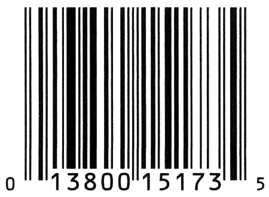

---
puppeteer:
    landscape: false
    format: "legal"
    printBackground: true
    mediaType: "screen"
    timeout: 1000 # Wait for 3000ms before export
    scale: 0.64
    margin: 0
---
@import "REY_ACADEMIA1.less"


<h1  style="font-size: 3.0em; margin-top:   0px; padding: 0" align=center>  Chapter 4                           </h1>
<h2  style="font-size: 2.0em; margin-top: -15px;"            align=center>  Expressions                         </h2>

<div style="font-size: 1.0em; margin-top:   0px;"            align=center>  CSE 4107 : Structured Programming I </div>
<div style="font-size: 1.0em; margin-top:   0px;"            align=center>  REYNEP                              </div>

</br>


<section class="S4">

## 4.0. Expressions
##### One of $\; C \;$’s distinguishing characteristics is it's emphasis on <u>**expressions**</u>
- **expressions** are ==formulas that show how to compute a value==
- **expressions** are ==built from *variables*, *constants* & *operators*==

##### <u>Operators</u> are the basic tools for building expressions, and ==C has an unusually rich collection of them:==
- **arithmetic** operators
- **relational** operators
- **logical** operators
- **assignment** operators
- **increment** and **decrement** operators 

</section>


<section class="S4">
</br>

## 4.1. Arithmetic Operators

<div class="REY_BR4_NEGATIVE"></div>
<hr>
<div class="REY_BR4_NEGATIVE"></div>


<div style="display: flex; align-items: flex-start; gap: 20px;">
<div style="flex: 1;">

##### <u>Binary</u> (**two** operands) Arithmetic Operators:
```cpp
addition                int x = 10 + 5;
subtraction             int x = 10 - 5;
multiplication          int x = 10 * 5;
division                int x = 10 / 5;
remainder = modulus     int x = 10 % 5;
```

</div>
<div style="flex: 1.35;">

##### <u>Unary</u> (**one** operands) Arithmetic Operators:
```cpp
                    int y =  7;
unary plus          int x = +y;     int m = +1;
unary minus         int x = -y;     int n = -2;
```
<div class="REY_BR6_NEGATIVE"></div>

==The 'unary plus' emphasizes that the numeric constant is positive==

</div>
</div>


<div class="REY_BR5_NEGATIVE"></div>
<hr>
<div class="REY_BR5_NEGATIVE"></div>


##### <u>Binary</u> (**two** operands) Arithmetic Operators allow:
- **int** operands
- **float** operands
- allow mixing of `int` & `float`
    - ==When `int` and `float` operands are **mixed**, the result has type `float`==
        - ==`9 + 2.5f` has the value `11.5`==
        - ==`6.7f / 2` has the value `3.35`==
        </br>
     
- **remainder** <u>operator</u> 
    - `int k = x % y;`
    - ==The value of `k` is now the **remainder** when `x` is divided by `y`==
        - ==`10 % 3` has the value `1`==
        - ==`12 % 4` has the value `0`==
        </br>

- ==All the <u>**Binary Arithmetic** Operators</u> allow `int`, `float`, or even **mixing**==
    - except for **remainder** operator `%`

</section>


<section class="S4">
</br>
</br>

<div style="display: flex; align-items: flex-start; gap: 20px;">
<div style="flex: 1;">

```cpp
float a =    9 + 2.5f;      // a = 11.5
float b = 6.7f / 2;         // b = 3.35
  int c =   10 % 3;         // c = 1
  int d =   12 % 4;         // d = 0
```

</br>
</br>

#### ivans lines 🟩
##### The `/` and `%` <u>operators</u> require special care:
</br>

- When both operands are `int`
    - `int x = 1/2;` ➡️ `x = 0` not `0.5`
    - `/` "<u>truncates</u>" the result.
    </br>


</div>
<div style="flex: 1.35;">

```cpp
int a =   1 / 2;            // a = 0
int b =   5 % 2;            // works
int c = 5.0 % 2;            // the program won't compile

int d = 6.0 / 0;            
    // undefined behavior

int e =  -5 /  2;            
int e =   5 / -2;            
    // C89: '-2' or '-3'    🤷‍♀️ varies from compiler to compiler 
    // C99: '-2' always         truncated towards zero.

int f =  -5 %  2;
int f =   5 % -2;
    // C89: varies from compiler to compiler 
    // C99: has the same sign as 'left-operand' 
```
</div>
</div>


- The `%` operator requires `int` operands
    - if either operand is not an `int`, the program won’t compile
    </br>

- Using `0` zero as the <u>right operand</u> of either `/` or `%` causes <u>undefined behavior</u>
    </br>

- <u>negative operands</u>
    - `C89`: The behavior when `/` and `%` are used with <u>negative operands</u> is <u>**implementation-defined** (see next page)</u>
    - `C99`: the result of a division is always truncated toward `0` zero and the value of `x % y` has the same sign as `x`

</section>


<div class="REY_NOSHOW_PDF">

-------------------------------------------------------------------
<div align=center style="font-size: 50px; font-family: 'Iosevka Curly'; ">Page-Break</div>
</div>
<div class="REY_PAGEBREAK"></div>
<div class="REY_NOSHOW_PDF">

-------------------------------------------------------------------
</div>


<section class="S4">
    </br>
    <div class="REY_NOSHOW_MD">
        </br>
        </br>
        </br>
        </br>
    </div>

## 4.1. Glossary

##### ***The $C$ Standard***
- Every language has a **"Manual"** or a **"Guide"** that all it's **compilers** must follow 
- It's better to call it _**The C Programming Language Compiler Specifications**_
    - or, **The C Compiler Specs.**
    - Now, this **Specs.** are made by **ISO** (International Organization for Standardization)
        - Since, what they do is, **"to Standardize"**
        - They name stuff **"... Standard"**
        - in our case, **"The C Standard"**
- old people just likes to call it **The $C$ Standard**
</br>

##### **Implementation** - what does it mean?
- different compilers are **made** diffrently
- different compilers are **implemented** diffrently
</br>

##### 🟩 <u>**implementation-defined**</u> behavior
- **The $C$ standard** deliberately leaves parts of the language, **unspecified**
    - However, this does, reflect $C$’s <u>emphasis on efficiency</u>, 
        - which often means <u>matching the way that hardware behaves</u>
        - e.g. in `C89`
            - `-9 / 7 = -1` it could be *this*
            - `-9 / 7 = -2` it could be *that*
            - 🤷‍♀️ we don't know
        - So, back in those days, people would have to "know" about the hardware differences & write different variations of code for different hardwares
        </br>

- So, different compilers will handle this **unspecified** part, differently.
    - So it varies as per **compiler-implementation**
    - So it's ***compiler-implementation-defined***
    - So it's **implementation-defined**
    </br>

- 🎴 It's best to **avoid** writing programs that depend on **implementation-defined** behavior

</section>


<section class="S4">

</br>
<div class="REY_BR5_NEGATIVE"></div>
<hr>
<div class="REY_BR5_NEGATIVE"></div>

### **Operator Precedence**
##### `i+j*k`
- is it `(i+j) * k`? or
- is it ` i + (j*k)`?
    </br>
- we should kind of, *always just use parentheses*
- and if *parentheses* are omitted, $C$ uses **operator precedence** rules to determine the meaning of the expression

    <div style="display: flex; align-items: flex-start; gap: 20px;">
    <div style="flex: 1;">

    ```cpp
    (Highest)   Level-1:        + -     (unary)
                Level-2:        * / %   (binary)
    (Lowest)    Level-3:        + -     (binary)
    ```

    </div>
    <div style="flex: 1;">

    ```cpp
     i +  j * k         is equivalent to            i  + ( j * k)
    -i * -j             is equivalent to          (-i) * (-j)
    +i +  j / k         is equivalent to          (+i) + ( j / k)
    ```

    </div>
    </div>

- When in doubt, *use this table* or just use **plenty of parentheses**
    
</br>

### **Operator <u>Associativity</u>**
```cpp
i - j – k       is equivalent to        (i - j) - k
i * j / k       is equivalent to        (i * j) / k
```
- **Associativity** comes into play when an expression contains two or more operators with *equal precedence*
    </br>

- The ***binary arithmetic** operators* (*, /, %, +, and -) are all **left associative**
    - An operator is said to be **left associative** if it groups from *left to right*
    </br>

- The ***unary arithmetic** operators* (+ and -) are both **right associative**
    - An operator is **right associative** if it groups from *right to left*

</br>
<div class="REY_BR5_NEGATIVE"></div>
<hr>
<div class="REY_BR5_NEGATIVE"></div>

</section>

<div class="REY_NOSHOW_PDF">

-------------------------------------------------------------------
<div align=center style="font-size: 50px; font-family: 'Iosevka Curly'; ">Page-Break</div>
</div>
<div class="REY_PAGEBREAK"></div>
<div class="REY_NOSHOW_PDF">

-------------------------------------------------------------------
</div>


<section class="S4">
</br>

## 4.1.2. Program : `Computing a UPC Check Digit` 🟩
For a number of years, manufacturers of goods sold in U.S. and Canadian stores have put a bar code on each product. 
- This code, known as a Universal Product Code (UPC), identifies both the manufacturer and the product. 
- Each bar code represents a twelve-digit number
    - which is usually printed underneath the bars. 
    - For example, 
        - the following bar code comes from a package of **Stouffer’s French Bread Pepperoni Pizza**:
            

        - 
            <div style="display: flex; align-items: flex-start; gap: 20px; margin-top: 10px;">
            <div style="flex: ;">

            The digits
            ```cpp 
            0 13800 15173 5
            ```

            </div>
            <div style="flex: 1;">

            appear underneath the bar code. 
            - The first digit identifies the type of item 
                - 0 or 7 for most items, 
                - 2 for items that must be weighed, 
                - 3 for drugs and health-related merchandise, and 
                - 5 for coupons. 
            - The first group (13800) of five digits identifies the manufacturer 
                - (13800 is the code for Nestlé USA’s Frozen Food Division). 
            - The second group of five digits identifies the product (including package size). 
            - The final digit is a “check digit,” whose only purpose is to help identify an error in the preceding digits. 
                - If the UPC is scanned incorrectly, the first 11 digits probably won’t be consistent with the last digit, and the store’s scanner will reject the entire code.

            </div>
            </div>


</br>
<div class="REY_BR5_NEGATIVE"></div>
<hr>
<div class="REY_BR5_NEGATIVE"></div>

##### Here’s one method of computing the check digit:
<div style="margin-top: 10px;"></div>

1. Add the Odd-Indexed Digits ➡️ `sum1` - i.e. first, third, fifth, seventh, ninth, and eleventh digits.
2. Add the Even-Indexed ➡️ `sum2` - i.e. second, fourth, sixth, eighth, and tenth digits.
3. Multiply `sum1` by 3 and add it to `sum2` ➡️ `total`
4. Subtract 1 from the `total`.
5. Compute the remainder when the adjusted total is divided by 10.
6. Subtract the remainder from 9.


##### Using the Stouffer’s example
1. we get 0 + 3 + 0 + 1 + 1 + 3 = 8 ➡️ `sum1`
2. 1 + 8 + 0 + 5 + 7 = 21 ➡️ `sum2` 
3. Multiplying `sum1` by 3 and adding `sum2` yields 45. ➡️ `total`
4. Subtracting 1 from `total` gives 44. 
5. The remainder upon dividing `total` by 10 is 4. 
6. When the remainder is subtracted from 9, the result is 5.

<div class="REY_BR5_NEGATIVE"></div>
<hr>
<div class="REY_BR6_NEGATIVE"></div>


</br>
</br>

##### Here are a couple of other UPCs, in case you want to try your hand at computing the check digit

<div style="display: flex; align-items: flex-start; gap: 20px;">
<div style="flex: ;">

(raiding the kitchen cabinet for the answer is not allowed). 
(The answers appear at the bottom of the page.)

</div>
<div style="flex: ;">

```cpp
          Jif Creamy Peanut Butter (18 oz.):    0 51500 24128 ?
Ocean Spray Jellied Cranberry Sauce (8 oz.):    0 31200 01005 ?
```

</div>
</div>

<div class="REY_BR6_NEGATIVE"></div>
<hr>
<div class="REY_BR5_NEGATIVE"></div>


##### **THE PROBLEM**: Let’s write a program that calculates the check digit for an arbitrary UPC.
<div style="margin-top: 10px;"></div>

<div style="display: flex; align-items: flex-start; gap: 20px;">
<div style="flex: ;">

- We’ll ask the user to enter the first 11 digits of the UPC, 
- then we’ll display the corresponding check digit. 
    </br>

</div>
<div style="flex: ;">

- To avoid confusion, we’ll ask the user to enter the number in three parts: 
    - the single digit at the left, 
    - the first group of five digits, 
    - and the second group of five digits. 
    </br>

</div>
</div>

<div style="margin-top: -63px;"></div>

- Here’s what a session with the program will look like:
    ```cpp
    Enter the first (single) digit: 0
    Enter first group of five digits: 13800
    Enter second group of five digits: 15173
    Check digit: 5
    ```
    - Instead of reading 
        - each digit group as a **"five-digit number"**, 
    - we’ll read it as 
        - five **"one-digit numbers"**. 
        </br>
 
    - Reading the numbers as single digits is more convenient; 
    - also, we won’t have to worry that 
        - maybe one of the five-digit numbers is too large to store in an `int` variable. 
            - i.e. Compilers 30years ago, in 1980s, used to see `int` as **16-bit** 
            - So, The Author Wrote This:
                - (Some older compilers limit the maximum value of an int variable to `32,767`). 
                </br>
 
    - To read single digits, we’ll use `scanf()` with the `%1d` **conversion specification**, 
        - `%1d` matches a one-digit integer

</section>


<section class="S4">
    </br>
    </br>
    </br>
    </br>
    </br>
    <div class="REY_NOSHOW_MD">
        </br>
        </br>
        </br>
        </br>
        </br>
        </br>
        </br>
        </br>
        </br>
        </br>
    </div>

##### **The Solution:**

</br>

##### Recall back to this:
<div class="REY_BR5_NEGATIVE"></div>
<hr>
<div class="REY_BR5_NEGATIVE"></div>

##### Here’s one method of computing the check digit:
<div style="margin-top: 10px;"></div>

1. Add the Odd-Indexed Digits ➡️ `sum1` - i.e. first, third, fifth, seventh, ninth, and eleventh digits.
2. Add the Even-Indexed ➡️ `sum2` - i.e. second, fourth, sixth, eighth, and tenth digits.
3. Multiply `sum1` by 3 and add it to `sum2` ➡️ `total`
4. Subtract 1 from the `total`.
5. Compute the remainder when the adjusted total is divided by 10.
6. Subtract the remainder from 9.


##### Using the Stouffer’s example
1. we get 0 + 3 + 0 + 1 + 1 + 3 = 8 ➡️ `sum1`
2. 1 + 8 + 0 + 5 + 7 = 21 ➡️ `sum2` 
3. Multiplying `sum1` by 3 and adding `sum2` yields 45. ➡️ `total`
4. Subtracting 1 from `total` gives 44. 
5. The remainder upon dividing `total` by 10 is 4. 
6. When the remainder is subtracted from 9, the result is 5.

<div class="REY_BR5_NEGATIVE"></div>
<hr>
<div class="REY_BR6_NEGATIVE"></div>
</br>

##### Now we implement:
```cpp
/* Computes a Universal Product Code check digit */
#include <stdio.h>

int main(void)
{
    int d;
        printf("Enter the first (single) digit: ");
        scanf("%1d", &d);

    int i1, i2, i3, i4, i5;
        printf("Enter first group of five digits: ");
        scanf("%1d%1d%1d%1d%1d", &i1, &i2, &i3, &i4, &i5);

    int j6, j7, j8, j9, j10;
        printf("Enter second group of five digits: ");
        scanf("%1d%1d%1d%1d%1d", &j6, &j7, &j8, &j9, &j10);

    int sum1  = d + i2 + i4 + j6 + j8 + j10;
    int sum2  =     i1 + i3 + i5 + j7 + j9;
    int total = 3*sum1 + sum2;


    int ans   = 9 - ((total - 1) % 10);

    printf("Check digit: %d\n", ans);
    return 0;
}   
```

- Note that the expression `9 - ((total - 1) % 10)` could have been written as `9 - (total - 1) % 10`, 
    - but the extra set of parentheses makes it easier to understand.

</section>


<div class="REY_NOSHOW_PDF">

-------------------------------------------------------------------
<div align=center style="font-size: 50px; font-family: 'Iosevka Curly'; ">Page-Break</div>
</div>
<div class="REY_PAGEBREAK"></div>
<div class="REY_NOSHOW_PDF">

-------------------------------------------------------------------
</div>


<section class="S4">
<div style="margin-top: 40px;"></div>

## 4.2. Assignment $=$ Operator $? \;\;\;\;\;\;\;\; \& \;\;\;\;\;\;\;$ **lvalue**
- **Simple** Assignment 🟩 used for storing a value into a variable
    
    <div style="display: flex; align-items: flex-start; gap: 10px;">
    <div style="flex: ;">

    ```cpp
    i = 5;
    j = i;
    k = 10*i + j;
    ```
    - The effect of the assignment `v = e` 
    - is to evaluate the expression `e` and 
      copy it's value into `v`
        - `e` $\coloneqq$ **Expression**
            - can be a **constant**
            - can be a **variable**
            - can be a **more complicated expression**
            </br>
    
    </div>
    <div style="flex: ;">

    ```cpp
    int i;      float f;
    i = 72.99f;
    f = 136;
    ```
    - **If** `v` and `e` don’t have the same type, 
      **then** the value of `e` is converted to the type of `v` as the assignment takes place:

    </div>  
    </div>
    </br>


- **Simple** Assignment : **SideEffects** 🟩
    ```cpp
    line 1:     k = k+ i=72.99f;                  // many languages won't allow this
    line 2:     k = k+   72.99f;   i=72.99f;      // But C does & both lines are same in C
    ```
    <div style="display: flex; align-items: flex-start; gap: 10px;">
    <div style="flex: 1;">

    - In $C$, _**assignment** is an operator_, just like `+`

    </div>
    <div style="flex: 1.2;">

    - 🟦 **assignment** being an operator
        - Simply means that, `line 1` in the above example is 'do-able'
        - However, In many programming languages, it is not 'do-able'
            - in those programming languages _**assignment** is a statement_.

    </div>
    </div>


    <div style="margin-top: -30px;"></div>

 
    - The value of `v=e` $\implies$ the value of `v` after the assignment
        - `int i` $\implies$ The value of `i = 72.99f` is `72`
        </br>
        <div style="margin-top: 15px;"></div>

    - Since _**assignment** is an operator_ in $C$, 
        <div style="display: flex; align-items: flex-start; gap: 10px;">
        <div style="flex: ;">

        - several assignments can be chained together:
            ```cpp
            int i, j, k;
            i = j = k = 0;
            ``` 
        
        </div>
        <div style="flex: ;">

        - The `=` operator is **right associative**, so this "chain of assignments" is equivalent to
            ```cpp
            int i, j, k;
            i = (j = (k = 0));
            ```
        </div>
        </div>
        </br>

        

    - An operator that modifies one of its operands is said to have a **side effect**
    - The _**simple** **assignment** operator_ has a **side effect**
        - it modifies its left operand
    - Evaluating the expression `i = 0` produces the result `0` and—as a side effect—assigns `0` to `i`
    </br>

    - Wath out of unexpected results in chained assignments as a result of type conversion:
        <div style="display: flex; align-items: flex-start; gap: 10px;">
        <div style="flex: ;">

        ```cpp
        int i;
        float f;

        f = i = 33.3f;
        ```
        - `i` is assigned the value `33`, 
          then `f = 33` (not $33.3$)
        
        </div>
        <div style="flex: ;">

        ```cpp
        int i = 1;
        int k = 1 + (j = i);

        printf("%d %d %d\n", i, j, k);          /* prints "1 1 2" */
        ```
        - An assignment of the form `j = i` is allowed wherever a value of type `j` would be permitted:
        - **“Embedded assignments”** can make programs hard to read.
        - They can also be a source of **subtle bugs**.
        </div>
        </div>
        </br>


- #### **Simple** _Assignment_ : **lvalue** 🟩
    - **lvalue** Represents an **object/locker** _stored in computer memory_,
        <div style="display: flex; align-items: flex-start; gap: 10px;">
        <div style="flex: ;">

        ```cpp
        2 = i;          /*** WRONG ***/
        i + j = 0;      /*** WRONG ***/
        -i = j;         /*** WRONG ***/
        ```
        - The compiler will produce an error message such as **“invalid lvalue in assignment”**
        
        </div>
        <div style="flex: ;">

        </br>

        - So, one could say,
        - **Variables** are **lvalues**
        - **constants** are **not**, **expressions** are **not**

        </div>
        </div>
        </br>

    <div style="display: flex; align-items: flex-start; gap: 10px;">
    <div style="flex: ;">

    - **lvalue** does not represent 
        - a constant or 
        - the result of a computation (which is also another constant)
        </br>
    
    </div>
    <div style="flex: ;">

    - > **Left operand** of a assignment _always has to be_ an **lvalue**

    </div>
    </div>


- #### **Compound** Assignment 🟩 
    <div style="display: flex; align-items: flex-start; gap: 10px;">
    <div style="flex: 1;">

    ```cpp
    i += 6      //      i = i + 2; 
    i -= 5      //      i = i - 2;
    i *= 4      //      i = i * 2; 
    i /= 3      //      i = i / 2;
    i %= 2      //      i = i % 2;
    ```
    - All **compound** assignment ops work in the same way:
        - These are assignments that use the old value of a variable to compute its new value & very common
        - There are 9 of them, including the following:
            - `-= *= /= %=`
            </br>
    
    - `i =+ j`  $\implies$  `i = (+j)`
        - which merely copies the value of `j` into `i`
        - So, when using them `+=`, be careful not to switch the two characters that make up the operator.
    
    </div>
    <div style="flex: 1.3;">

    ```cpp
    i *=     j+k;
    i  = i * j+k;       // These 2 are not the same

    i *=     j+k;
    i  = i *(j+k);      // However these 2 are same.   
    ```
    - So, **ivan** says
        - `v += e` **isn’t “equivalent”** to `v = v+e`
            - he really should have clarified, that he means **"multiple ops"** inside `e`
        - One problem is operator precedence:
            - as in the example above
        - There are also different rathermore rare cases in which 
            - `v += e` differs from `v = v+e` because `v` itself has a side effect.
            - Similar remarks apply to the other compound assignment operators
            </br> 

    </div>
    </div>

</section>

<div class="REY_NOSHOW_PDF">

-------------------------------------------------------------------
<div align=center style="font-size: 50px; font-family: 'Iosevka Curly'; ">Page-Break</div>
</div>
<div class="REY_PAGEBREAK"></div>
<div class="REY_NOSHOW_PDF">

-------------------------------------------------------------------
</div>


<section class="S4">
</br>
</br>
</br>
</br>
</br>
</br>
</br>
</br>
</br>

## 4.3. Increment & Decrement Operators

##### Two of the most common operations on a variable are 
<div style="display: flex; align-items: flex-start; gap: 10px;">
<div style="flex: 1;">

```cpp
i = i + 1; 
j = j - 1;
```
1. **“incrementing”** (adding `1`) 
2. **“decrementing”** (subtracting `1`)

</div>
<div style="flex: 1;">

```cpp
i += 1;     // 1. incrementing
j -= 1;     // 2. decrementing
```
- can be also done using the **Compound** assignment operators, like above

</div>
</div>


<div style="display: flex; align-items: flex-start; gap: 10px;">
<div style="flex: 1.2;">

```cpp
i++;        // i += 1
j++;        // j += 1
```
##### 🟩 **ivan's** lines
- $C$ provides special `++` (increment) and `--` (decrement) operators.
- The `++` operator adds 1 to its operand. The `--` operator subtracts 1.
- The **increment** and **decrement** operators are tricky to use:
    - They can be used as 
        - **prefix** operators (`++i` and `--i`) or 
        - **postfix** operators (`i++` and `i--`)
    - They have **side effects**: 
        - they modify the values of their operands

</div>
<div style="flex: 1;">

```cpp
++i;        // another way
++j;        // another way
```

</div>
</div>


</br>

### **postfix** vs **prefix** operators

<div style="display: flex; align-items: flex-start; gap: 10px;">
<div style="flex: 0.75;">

`++i` (a **“pre-increment”**) 

```cpp
int i = 1;
printf("i is %d\n", ++i);   /* prints "i is 2" */
printf("i is %d\n", i);     /* prints "i is 2" */

int i = 1;
printf("i is %d\n", --i);   /* prints "i is 0" */
printf("i is %d\n", i);     /* prints "i is 0" */
```
- `++i` $\implies$ **increment `i` immediately**
- Evaluating the expression `++i`
    - yields `i+1` and as a side effect $\to$ increments 

</div>
<div style="flex: 1;">

`i++` (a **“post-increment”**) 

```cpp
int i = 1;
printf("i is %d\n", i++);   /* prints "i is 1" */
printf("i is %d\n", i);     /* prints "i is 2" */

int i = 1;
printf("i is %d\n", i--);   /* prints "i is 1" */
printf("i is %d\n", i);     /* prints "i is 0" */
```
- `i++` $\implies$ **use the old value** of `i` for now, but **increment** `i` **later**
- Evaluating the expression `i++`
    - produces the result `i`, but causes `i` to be incremented afterwards
    </br>
- How much later? 
    - The $C$ standard doesn’t specify a precise time, but 
        - it’s safe to assume that i will be incremented before the next statement is executed 

</div>
</div>


</br>
</br>

##### When `++` or `--` is used more than once in the same expression, the result can often be hard to understand.

<div style="display: flex; align-items: flex-start; gap: 10px;">
<div style="flex: 0.75;">

```cpp
int i = 1;
int j = 2;
int k = ++i + j++;
```
- This statement is equivalent to the on on the right

</div>
<div style="flex: 1;">

```cpp
int i = 1;
int j = 2;
    i = i + 1;      // i = 1+1
    k = i + j;      // k = 2+2
    j = j + 1;      // j = 2+1
```

</div>
</div>


<div style="display: flex; align-items: flex-start; gap: 10px;">
<div style="flex: 0.75;">

```cpp
int i = 1;
int j = 2;
int k = i++ + j++;
```
- both are **postfix ops** here

</div>
<div style="flex: 1;">

```cpp
    .
    .
    k = i+j;    i+=1;     j+=1;
```
- This is the breakdown of the one on the left

</div>
</div>

</section>
<div class="REY_NOSHOW_PDF">

-------------------------------------------------------------------
<div align=center style="font-size: 50px; font-family: 'Iosevka Curly'; ">Page-Break</div>
</div>
<div class="REY_PAGEBREAK"></div>
<div class="REY_NOSHOW_PDF">

-------------------------------------------------------------------
</div>


<section class="S4">
</br>

## 4.4. Expression Evaluation
<div align=center>

##### **Updated Precedence Table**
| Precedence      | Name                | Symbol             | Associativity |
| :-------------: | :------------------ | :----------------: | :------------ |
| **1** (Highest) | increment (postfix) | `i++`              | left          |
|                 | decrement (postfix) | `i--`              |               |
| **2**           | increment (prefix)  | `++i`              | right         |
|                 | decrement (prefix)  | `--i`              |               |
|                 | unary plus          | `+x`               |               |
|                 | unary minus         | `-x`               |               |
| **3**           | multiplicative      | `*` `%`            | left          |
| **4**           | additive            | `+` `-`            | left          |
| **5** (lowest)  | assignment          | `= *= /= %= += -=` | right         |

</div>


<div style="display: flex; align-items: flex-start; gap: 10px;">
<div style="flex: 0.75;">

```cpp
                                                 Precedence level
 a =  b +=    c++  - d  +   --e  /  -f           
 a =  b +=   (c++) - d  +   --e  /  -f                  1
 a =  b +=   (c++) - d  +  (--e) / (-f)                 2
 a =  b +=   (c++) - d  + ((--e) / (-f))                3
 a =  b += (((c++) - d) + ((--e) / (-f)))               4
(a = (b += (((c++) - d) + ((--e) / (-f)))))             5
```

</div>
<div style="flex: 1;">
<div style="margin-top: 38px;"> </div>

The table can be used to add parentheses to an expression that lacks them.

Starting with the operator with highest precedence put parentheses around the operator and its operands.

</div>
</div>


</br>

##### Order of Subexpression Evaluation 🟩
- $C$ does define the order for these subexpressions 
    - `&&`
    - `||` 
    - lines that have comma operators $\implies$ `int a = 0, b = 1;`
    - conditional

<div style="display: flex; align-items: flex-start; gap: 10px; margin-top: -15px;">
<div style="flex: ;">

```cpp
int a, b, c;
a = 5;
c = (b = a+2) - (a = 1);      // Undefined behavior
```

</div>
<div style="flex: 1;">
<div style="margin-top: 30px;"> </div>

The value of an expression may depend on the order in which its subexpressions are evaluated

</div>
</div>
 
- $C$ doesn’t define the order in which subexpressions are evaluated, normally
    - Is it `(a = 1)` first?
    - Is it `(b = a+2)` first?
    - Say for the the expression, `(a+b) * (c-d)`
        - we don’t know whether `(a+b)` will be evaluated before `(c-d)`
        <div style="margin-top: 20px;"> </div>
         
    - > Most expressions have the same value regardless of the order in which their subexpressions are evaluated
      > However, this may not be true when a subexpression modifies one of its operands:
        <div style="margin-top: -12px;"> </div>

        ```cpp
        int a, b, c;
        a = 5;
        c = (b = a+2) - (a = 1);      // Undefined behavior
        ```
        - The effect of executing the second statement is undefined
        </br>

    - We could use a series of separate assignments instead:
        <div style="display: flex; align-items: flex-start; gap: 10px;">
        <div style="flex: 0.75;">

        ```cpp
        a = 5;
        b = a + 2;
        a = 1;
        c = b - a; // The value of c will always be 6
        ```
        
        </div>
        <div style="flex: 1;">
        <div style="margin-top: 24px;"> </div>

        - Avoid writing expressions that access the value of a variable and also modify the variable elsewhere in the expression 
            - Some compilers may produce a warning message, if you do so....
        - It’s a good idea to avoid using the assignment operators in subexpressions.

        </div>
        </div> 

 
        </br>
    
- Besides the assignment operators, the only operators that modify their operands are increment and decrement.
    <div style="display: flex; align-items: flex-start; gap: 10px;">
    <div style="flex: ;">

    ```cpp
    i = 2;
    j = i * i++;
    ```
    
    </div>
    <div style="flex: 1;">
    <div style="margin-top: 15px;"> </div>

    - It’s natural to assume that `j` is assigned `4`. However, `j` could just as well be assigned `6` instead:
        1. The second operand (the original value of `i`) is fetched, then `i` is incremented
        2. The first operand (the new value of `i`) is fetched
        3. The new and old values of `i` are multiplied, yielding `6`
        </br>

    </div>
    </div> 

    - When using these operators, be careful that an expression doesn’t depend on a particular order of evaluation
    </br>

##### Undefined Behavior 🟩
- Statements such as `c = (b = a + 2) - (a = 1);` and `j = i * i++;` cause undefined behavior
- Possible effects of undefined behavior:
    - The program may **behave differently** _when compiled with different compilers_
    - The program **may not compile** in the first place
    - The program may compile, and, If it compiles it **may not run**
    - The program may compile & run, and, If it does run, the program **may crash, behave erratically**, or produce meaningless results
    </br>
- Code that leads to **Undefined behavior**, should be avoided

</section>

<div class="REY_NOSHOW_PDF">

-------------------------------------------------------------------
<div align=center style="font-size: 50px; font-family: 'Iosevka Curly'; ">Page-Break</div>
</div>
<div class="REY_PAGEBREAK"></div>
<div class="REY_NOSHOW_PDF">

-------------------------------------------------------------------
</div>


<section class="S4">
</br>

## 4.5. Expression Statements 🟩
- Expressions can be discarded. 
    - So there’s little point in using an expression as a statement unless the expression has a side effect:
        ```cpp
        i = 1;          /* useful */
        i--;            /* useful */
        i * j - 1;      /* not useful */ 
        ```
        - by "side effect", author meant, an expression that changes some values in memory
        </br>
    - Expressions can be used as a statement by appending ‘;’
    </br>
 
 
- A slip of the finger can easily create a “do-nothing” expression statement
- For example, 
    - instead of entering `i = j` 
    - we might accidentally type `i + j`
    </br>
 
- Some compilers can detect meaningless expression statements; 
    - you’ll get awarning such as “statement with no effect.”


</br>
</br>
</br>
</br>
<hr>

# **The End**

<hr>

</section>