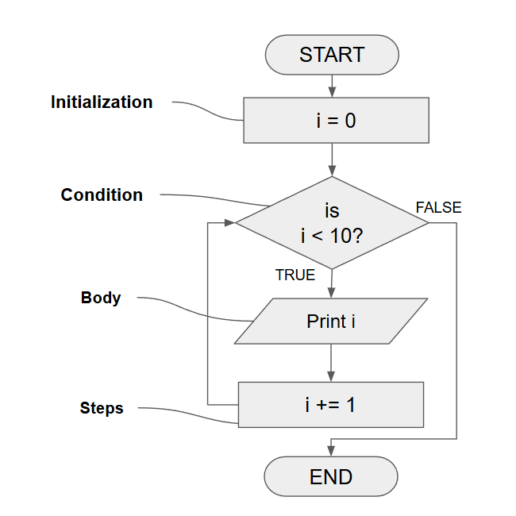

---
puppeteer:
    landscape: false
    format: "legal"
    printBackground: true
    mediaType: "screen"
    scale: 0.64
    margin: 0
---
@import "REY_ACADEMIA1.less"


</br>

<h1  style="font-size: 3.0em; margin-top:   0px; padding: 0" align=center>  Chapter 6                           </h1>
<h2  style="font-size: 2.0em; margin-top: -15px;"            align=center>  Loops                </h2>

<div style="font-size: 1.0em; margin-top:   0px;"            align=center>  CSE 4107 : Structured Programming I </div>
<div style="font-size: 1.0em; margin-top:   0px;"            align=center>  REYNEP                              </div>

</br>


<section class="S4">

## 6.1. The `while` statement

<div style="display: flex; align-items: flex-start; gap: 10px;">
<div style="flex: ; margin-left: -60px">



</div>
<div style="flex: ; margin-left: -40px;">

```cpp
#include <stdio.h>

int main(void) 
{
    int i = 0;
    while (i < 10)       /* ctrl-expr */  
    {            
        printf("%d\n", i);  // Loop-Body
        i++;                // Loop-Body
    }
}
```

</div>
<div style="flex: 1; margin-right: -25px;">

The **while** statement 
- has the form 
    ```cpp
    while ( ctrl-expr ) {
        statements
    }
    ```
- is the easiest way to set up a loop

</div>
</div>


</section>